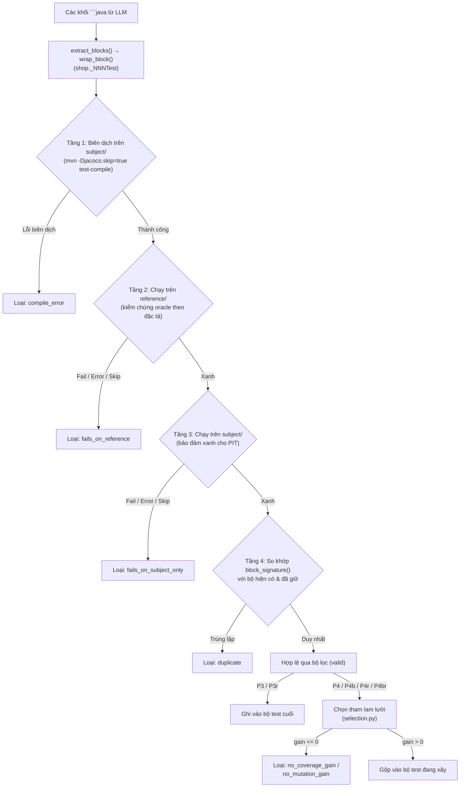

# Chương 3. Phương pháp đề xuất

Chương này trình bày kiến trúc hệ thống và các chiến lược sinh, lọc, chọn kiểm thử bằng mô hình ngôn ngữ lớn (LLM) được xây dựng trong đề tài, gồm chuỗi chính đủ ngữ cảnh — sinh trực tiếp (**P3**), sinh lặp có phản hồi độ bao phủ (**P4**), mở rộng phản hồi đột biến (**P4b**) — và chuỗi thí nghiệm bóc tách ngữ cảnh hạn chế (**P3r → P4r → P4br**, quyết định D-024). Toàn bộ mô tả, thuật toán mã giả và cấu trúc prompt bám sát mã nguồn thực tế trong `tools/`, `prompts/` và `experiments/`.

---

## 3.1 Kiến trúc tổng thể

Hệ thống được thiết kế theo kiến trúc đường ống khép kín gồm năm thành phần tách biệt rõ vai trò, giao tiếp thông qua các tệp cấu hình (`experiments/config/default.yaml`) và định dạng trao đổi chuẩn hóa (JSON/XML/Java):

1. **Đầu vào cố định (đóng băng tại mốc M1):** Bao gồm hợp đồng API (`docs/spec/api.md`), bộ đặc tả nghiệp vụ chi tiết (`docs/spec/*.md`) quy định tiền điều kiện, thứ tự kiểm tra ngoại lệ và giá trị biên, cùng mã nguồn chương trình đối tượng (`subject/src/main/java/shop/*.java`). Chuỗi chính (P3, P4, P4b) sử dụng cả đặc tả và toàn bộ mã nguồn; chuỗi ngữ cảnh hạn chế (P3r, P4r, P4br) chỉ cấp đặc tả + hợp đồng API ở bước khởi đầu và chỉ bổ sung đoạn mã cục bộ quanh vị trí thiếu phủ hoặc mutant còn sống trong phản hồi.
2. **Mô-đun dựng prompt, gọi LLM và ghi nhật ký (`prompts/`, `tools/svv/llm_client.py`):** Đóng gói việc lắp ghép prompt tất định từ sáu thư mục mẫu trong `prompts/`, thực thi lời gọi tới mô hình ngôn ngữ (hỗ trợ ba nhà cung cấp `codex-cli`, `agy-cli`, `anthropic`) và ghi đầy đủ thông tin mỗi lượt gọi (prompt, phản hồi, thời gian, token, chi phí, sự kiện công cụ, lỗi) vào `results/llm-logs/<method>/run-XX/calls.jsonl`.
3. **Bộ tách khối và lọc kiểm chứng bốn tầng (`tools/svv/test_blocks.py`, `tools/svv/test_filter.py`):** Phân tách phản hồi của LLM thành từng ca kiểm thử độc lập, bọc thành lớp JUnit 5 hoàn chỉnh và kiểm chứng lần lượt qua biên dịch trên `subject/`, chạy xác thực oracle trên chương trình tham chiếu độc lập `reference/`, chạy xác nhận trên `subject/` và loại trùng lặp.
4. **Hạ tầng đo lường cô lập (`experiments/scripts/measure.py`, `tools/mutate_custom.py`):** Thực thi bộ kiểm thử trong thư mục tạm `.work/` (không bao giờ ghi bẩn vào `subject/src/test/java/`), đo độ bao phủ bằng JaCoCo (`tools/svv/jacoco.py`) và kiểm thử đột biến bằng PIT kết hợp đột biến mã nguồn (`tools/svv/pit.py`, `tools/svv/custom_mutation.py`), xuất kết quả đã kiểm hợp lệ lược đồ JSON (`experiments/schema/run-result.schema.json`).
5. **Bộ trích xuất phản hồi và chọn test tham lam (`tools/svv/feedback.py`, `tools/svv/selection.py`):** Trích xuất ngữ cảnh dòng/nhánh chưa phủ (cho P4, P4r) hoặc danh sách mutant còn sống (cho P4b, P4br) theo từng phương thức, đồng thời áp dụng thuật toán chọn tham lam lười (lazy greedy với hàng đợi ưu tiên) để chỉ giữ lại những ca kiểm thử thực sự làm tăng độ bao phủ hoặc tiêu diệt thêm mutant.

Hình 3.1 (lưu riêng tại [figures/kien-truc-tong-the.md](figures/kien-truc-tong-the.md)) minh họa luồng xử lý tổng thể của hệ thống.

```mermaid
flowchart LR
    subgraph Input["1. Đầu vào cố định (M1)"]
        SPEC["Đặc tả nghiệp vụ & API\n(docs/spec/*.md)"]
        SRC["Mã nguồn đối tượng\n(subject/src/main/java/shop/)"]
    end

    subgraph Gen["2. Sinh test bằng LLM"]
        PROMPT["Bộ tạo prompt (prompts/)\nĐủ ngữ cảnh: direct, coverage-guided, mutation-feedback\nHạn chế: direct-spec-only, *-reduced"]
        LLM["llm_client.py\ncodex-cli / agy-cli / anthropic"]
        LOG["Nhật ký calls.jsonl"]
    end

    subgraph Filter["3. Lọc bốn tầng (test_filter.py)"]
        PARSE["Tách khối @Test\n& bọc lớp JUnit 5"]
        COMP["1. Biên dịch\n(subject/)"]
        REF["2. Kiểm oracle\n(reference/)"]
        SUBJ["3. Xác nhận\n(subject/)"]
        DEDUP["4. Loại trùng"]
    end

    subgraph Measure["4. Đo lường & Chọn lọc (.work/)"]
        SEL["Chọn tham lam lười\n(selection.py: P4/P4b/P4r/P4br)"]
        JUNIT["JUnit 5 + JaCoCo\n(LINE, BRANCH, METHOD)"]
        MUT["PIT + mutate_custom.py\n(5 toán tử)"]
    end

    subgraph Feedback["5. Trích xuất phản hồi (feedback.py)"]
        FB_COV["coverage_feedback()\nDòng/nhánh chưa phủ ±2 dòng"]
        FB_MUT["mutation_feedback()\nMutant SURVIVED / NO_COVERAGE"]
    end

    SPEC --> PROMPT
    SRC -->|"Chuỗi chính P3/P4/P4b"| PROMPT
    PROMPT --> LLM
    LLM --> LOG
    LLM --> PARSE --> COMP --> REF --> SUBJ --> DEDUP --> SEL --> JUNIT --> MUT
    JUNIT --> FB_COV -->|"Lặp P4 / P4r"| PROMPT
    MUT --> FB_MUT -->|"Lặp P4b / P4br"| PROMPT
```



### Quy ước định dạng khối test độc lập

Để có thể lọc, đo đóng góp và đếm chính xác ở mức từng ca kiểm thử mà không cần sửa tay mã do LLM sinh (thiết kế 6.2, `tools/svv/test_blocks.py`), hệ thống yêu cầu LLM trả về mỗi ca kiểm thử trong một khối mã ```` ```java ```` riêng biệt, chứa **duy nhất một phương thức `@Test` hoặc `@ParameterizedTest` tự chứa** (không dùng hàm phụ, không dùng trường lớp dùng chung, không dùng `@BeforeEach`/`@AfterEach`, không phụ thuộc đồng hồ hệ thống hay số ngẫu nhiên). Hàm `extract_blocks()` tìm mọi khối ```` ```java ````, loại bỏ khai báo `package`, gom các lệnh `import` riêng nếu có, gỡ vỏ lớp ngoài nếu LLM vô tình bọc thêm lớp (`_unwrap_outer_class`), kiểm tra đúng một annotation kiểm thử ở mức ngoài cùng (`_count_top_level_test_annotations == 1`), sau đó `wrap_block()` bọc mỗi khối thành một tệp nguồn riêng `shop.<Prefix>_NNNTest.java` kèm sáu câu lệnh `STANDARD_IMPORTS` chuẩn (`org.junit.jupiter.api.*`, `static org.junit.jupiter.api.Assertions.*`, `org.junit.jupiter.params.*`, `org.junit.jupiter.params.provider.*`, `java.time.*`, `java.util.*`).

---

## 3.2 Sinh test trực tiếp (P3 và biến thể ngữ cảnh hạn chế P3r)

Chiến lược sinh trực tiếp một lượt được cài đặt thống nhất trong `tools/generate_p3.py` với hai biến thể chọn qua cờ `--variant`:

- **`--variant full` → P3 (`p3-direct-llm`):** Gửi đồng thời hợp đồng API, toàn bộ đặc tả nghiệp vụ và toàn bộ mã nguồn `subject/src/main/java/shop/*.java` trong một lượt gọi LLM duy nhất; đóng vai trò đối chứng cơ sở không có vòng phản hồi cho P4 và P4b.
- **`--variant spec-only` → P3r (`p3r-spec-only`):** Biến thể khởi đầu của thí nghiệm bóc tách ngữ cảnh hạn chế (D-024), chỉ gửi hợp đồng API và đặc tả nghiệp vụ (`prompts/direct-spec-only/`), **không** đưa mã nguồn cài đặt vào prompt; hàm `build_prompt()` kiểm tra cưỡng bức và báo lỗi nếu mẫu `direct-spec-only` chứa bất kỳ biến `{{SOURCE}}` nào.

Quy trình thực hiện của `generate()` trong `tools/generate_p3.py` cho mỗi lần chạy `run-XX` gồm bốn bước:

1. **Lắp ghép prompt tất định (`build_prompt()`):**
   - Đọc hai tệp `system.md` và `generate.md` từ `prompts/direct/` (hoặc `prompts/direct-spec-only/`), chuẩn hóa ký tự xuống dòng sang LF (`_read_lf`) để bảo đảm mã băm nhất quán trên Windows.
   - Đọc `docs/spec/api.md` cho biến `{{API}}`; ghép các tệp đặc tả nghiệp vụ theo thứ tự cố định `CANONICAL_SPEC_ORDER` (`README.md`, `domain.md`, `cart.md`, `pricing.md`, `shipping.md`, `order.md`, `branches.md`, bỏ qua `api.md` và `open-questions.md`) cho biến `{{SPEC}}`.
   - Riêng với biến thể `full`, đọc toàn bộ tệp `.java` trong `subject/src/main/java/shop/` theo thứ tự từ điển tên tệp cho biến `{{SOURCE}}`.
   - Ghép `system.md` và phần thân đã thay thế bằng dấu phân tách `\n\n---\n\n`, kiểm tra không còn biến thay thế nào bị sót, rồi tính bốn mã băm SHA-256 (`system_sha256`, `generate_sha256`, `template_sha256`, `rendered_sha256`) và độ dài ký tự `chars` (với `PROMPT_VERSION = "1.0"`).
2. **Gọi LLM đúng một lần (`_call_llm()`):** Ghi đè `llm.timeout_s` bằng `p3.timeout_s` (`1800` giây trong `experiments/config/default.yaml`) mà không làm thay đổi tệp cấu hình, sau đó gọi `llm_client.complete(..., method=method, run=run, purpose="direct")`. Lỗi hết hạn mức (`LlmQuotaExceeded`) trả về mã thoát `2` để trình điều phối `run_experiment.py` dừng sạch và in lệnh tiếp tục.
3. **Tách khối và lọc kiểm chứng bốn tầng:** Trích danh sách khối bằng `extract_blocks(llm_res.text)` và gọi `filter_tests(blocks, class_prefix="P3", start_index=1, root=root)` mà **tuyệt đối không sửa tay** mã do LLM sinh ra.
4. **Xuất bộ kiểm thử và siêu dữ liệu:** Xóa tệp `.java` cũ trong `test-suites/<method>/run-XX/` (nếu ghi đè), ghi từng khối hợp lệ thành tệp `P3_NNNTest.java` qua `write_suite()`, và ghi `generation.json` chứa thời gian sinh (`generation_s`), thông số LLM (`provider`, `calls=1`, `input_tokens`, `cached_input_tokens`, `output_tokens`, `reasoning_output_tokens`, `tool_events`, `duration_s`, `cost_usd`, `model`, `effort`), thông tin prompt (phiên bản, mã băm SHA-256, `chars`, danh sách tệp đặc tả/mã nguồn), cùng thống kê bộ lọc trong cả trường `filter` (`oracle_correct_rate`) và trường `tests` (`oracle_rate`, tương thích với `measure.py`). Ngoài ra, cờ `--dry-run` cho phép in toàn bộ prompt đã lắp ghép cùng độ dài ký tự và các mã băm mà không gọi LLM.

---

## 3.3 Sinh test có phản hồi coverage (P4/P4r) và phản hồi mutation (P4b/P4br)

### Thiết kế ghép cặp và thí nghiệm bóc tách theo giai đoạn

Theo quyết định D-003 và cài đặt thực tế trong `tools/generate_p4.py` (`CHAINS`), đề tài áp dụng **thiết kế ghép cặp (paired design)** theo từng chỉ số lần chạy `run-XX` cho cả hai chuỗi:

- **Chuỗi chính (đủ ngữ cảnh — `--variant full`):** `p3-direct-llm` → `p4-coverage-guided` → `p4b-mutation-feedback`.
- **Chuỗi ngữ cảnh hạn chế (`--variant reduced`, D-024):** `p3r-spec-only` → `p4r-coverage-guided` → `p4br-mutation-feedback`.

Cơ chế kế thừa và cộng dồn chi phí được thực thi nghiêm ngặt như sau:

- **Kế thừa bộ test nền (`paired_generation()`):** Giai đoạn phản hồi coverage (**P4** / **P4r**) bắt đầu từ bản sao của toàn bộ tệp `.java` trong bộ giữ lại của **P3** / **P3r** cùng `run-XX`; giai đoạn phản hồi mutation (**P4b** / **P4br**, bật qua cờ `--mutation-feedback`) bắt đầu từ bộ cuối của **P4** / **P4r** cùng `run-XX`. Hàm `paired_generation()` xác minh `generation.json` của phương pháp cha có đủ trường `generation_s`, `tests` và `llm.{calls, input_tokens, output_tokens}` để tránh thiếu chi phí kế thừa.
- **Quy ước tính token và cộng dồn chi phí (`_combined_usage()`):**
  - Tổng token của mỗi giai đoạn được tính theo công thức $\text{total\_tokens} = \text{input\_tokens} + \text{output\_tokens}$ (không cộng trùng `cached_input_tokens` và `reasoning_output_tokens`, vì các trường này được lưu tách riêng để phân tích chi tiết).
  - Điều kiện dừng theo ngân sách `token_budget` chỉ kiểm tra lượng token **phát sinh riêng trong giai đoạn hiện tại** (`incremental["total_tokens"]`), giúp P4 và P4b mỗi giai đoạn có ngân sách độc lập (`400.000` cho P4/P4r và `300.000` cho P4b/P4br).
  - Trong `generation.json` cuối cùng, trường `generation_s` và `llm` lưu **tổng cộng dồn** (cha + phần tăng thêm), đồng thời tách rõ hai khối `inherited` (từ phương pháp cha) và `incremental` (phần phát sinh thêm cùng danh sách `dropped_by_selection`). Nếu bất kỳ giai đoạn nào có `calls > 0` mà `cost_usd` là `null` (chưa áp bảng giá USD), `cost_usd` cộng dồn giữ nguyên `null`.

### Thí nghiệm bóc tách "ngữ cảnh hạn chế" (P3r → P4r → P4br, D-024)

Trong quá trình chạy thí nghiệm sơ bộ với chuỗi chính đủ ngữ cảnh, nhóm ghi nhận **hiệu ứng trần (ceiling effect)** đúng như cảnh báo thiết kế ở Chương 4: khi LLM hiện đại được cung cấp toàn bộ đặc tả lẫn toàn bộ mã nguồn của một module gọn (235 dòng, 174 nhánh), bộ kiểm thử sinh trực tiếp một lượt có xu hướng đạt bão hòa sớm về cả độ bao phủ lẫn điểm đột biến, khiến các vòng lặp phản hồi phía sau không còn nhánh thiếu hoặc mutant sống để cải thiện và làm mờ khả năng phân biệt đóng góp của vòng phản hồi cho **RQ2** và **RQ4** (chi tiết số liệu được báo cáo đầy đủ tại Chương 5).

Theo quyết định **D-024**, đề tài giữ nguyên thiết kế chính (`P3 → P4 → P4b`) để báo cáo trung thực kết quả trong điều kiện đủ ngữ cảnh, đồng thời bổ sung một **thí nghiệm bóc tách theo điều kiện ngữ cảnh hạn chế (`P3r → P4r → P4br`)**:

1. **P3r (`p3r-spec-only`):** Sinh test hộp đen (black-box) một lượt chỉ từ hợp đồng API và đặc tả nghiệp vụ (`docs/spec/`), **không** cấp mã nguồn `subject/`. Bối cảnh này phản ánh sát thực tiễn kỹ nghệ phần mềm khi kiểm thử viên thiết kế test theo đặc tả độc lập với mã cài đặt.
2. **P4r (`p4r-coverage-guided`):** Khởi đầu từ bộ test của P3r cùng `run-XX`. Ở mỗi vòng phản hồi, prompt (`prompts/coverage-guided-reduced/generate.md`) vẫn không đưa toàn bộ mã nguồn `subject/`, mà chỉ bổ sung **đoạn mã cục bộ** quanh các dòng và nhánh còn chưa phủ do `coverage_feedback()` trích xuất từ báo cáo JaCoCo.
3. **P4br (`p4br-mutation-feedback`):** Khởi đầu từ bộ cuối của P4r cùng `run-XX`. Prompt (`prompts/mutation-feedback-reduced/generate.md`) không đưa toàn bộ mã nguồn, mà chỉ cung cấp **dòng mã chứa mutant cùng mô tả phép đột biến** của các mutant còn sống do `mutation_feedback()` trích xuất từ PIT và `mutate_custom.py`.

Chuỗi ngữ cảnh hạn chế sử dụng **cùng cấu hình LLM, cùng ngân sách token, cùng điều kiện dừng và cùng cơ chế lọc/chọn tham lam** như chuỗi chính, cho phép bóc tách rõ ràng tác dụng thực sự của phản hồi coverage và phản hồi mutation khi bộ kiểm thử khởi đầu chưa chạm trần. Luồng ghép cặp và vòng lặp của cả hai chuỗi được minh họa tại Hình 3.2 ([figures/vong-lap-p4-p4b.md](figures/vong-lap-p4-p4b.md)).

### Thuật toán 1: Sinh test có phản hồi coverage (P4 / P4r)

Mã giả dưới đây phản ánh chính xác cài đặt hàm `generate()` (với `mutation_feedback=False`), `stopping_reason()` trong `tools/generate_p4.py` và `select_greedy()` trong `tools/svv/selection.py`:

```text
Thuật toán 1: Coverage-guided LLM Test Generation (P4 / P4r)
Đầu vào:
  - variant ∈ {"full", "reduced"}  (full: P3 → P4; reduced: P3r → P4r)
  - S_parent: bộ test hợp lệ và generation.json của P3 (hoặc P3r) run-XX
  - Spec, Source: đặc tả docs/spec/ và mã nguồn subject/src/main/java/shop/
  - Cấu hình p4: max_iterations (M; dùng demo_max_iterations nếu --demo),
                 target_branch_coverage (B_target), token_budget (T_max),
                 stop_if_no_gain_iterations (K_stall), timeout_s
Đầu ra:
  - Thư mục bộ test cuối test-suites/<method>/run-XX/ (hoặc .work/demo/ nếu --demo)
  - Tệp generation.json (gồm baseline, final, stop_reason, iterations, inherited, incremental)

 1: sao chép toàn bộ *.java từ S_parent sang thư mục staging suite
 2: existing ← suite_blocks(suite)
 3: current ← measure_suite(suite, mutation=False)        // JUnit 5 + JaCoCo cô lập
 4: baseline ← current.metrics()                          // {statement_pct, branch_pct}
 5: incremental ← usage_rỗng()                            // calls=0, total_tokens=0
 6: tests ← bản sao bộ đếm (generated, compiled, passed_reference, valid, dropped) của S_parent
 7: iterations ← [];  selection_drops ← [];  no_gain ← 0;  next_index ← 1
 8: while True do
 9:     // Kiểm tra 4 điều kiện dừng theo đúng thứ tự của stopping_reason()
10:     if current.metrics().branch_pct >= B_target then
11:         stop_reason ← "target_branch_coverage";  break
12:     if incremental.total_tokens >= T_max then
13:         stop_reason ← "token_budget";  break
14:     if no_gain >= K_stall then
15:         stop_reason ← "stop_if_no_gain_iterations";  break
16:     if |iterations| >= M then
17:         stop_reason ← "max_iterations";  break
18:
19:     i ← |iterations| + 1
20:     fb ← coverage_feedback(current.uncovered, Source, context=2)
21:     prompt ← render_prompt(Spec, Source nếu variant="full",
22:                            tên_hàm(existing), fb)
23:
24:     resp ← llm_client.complete(prompt, method, run=XX,
25:                                purpose=f"[demo-]{method}-iteration-{i}",
26:                                timeout=p4.timeout_s)
27:     incremental ← _combined_usage(incremental, resp)  // total_tokens = input + output
28:
29:     candidates ← extract_blocks(resp.text)
30:     filtered ← filter_tests(candidates, existing=existing,
31:                             class_prefix="P4", start_index=next_index)
32:     next_index ← next_index + |candidates|
33:
34:     // Chọn tham lam lười (max-heap): chỉ giữ test có ΔLINE + ΔBRANCH > 0 và không giảm chỉ số nào
35:     selected, current ← select_greedy(filtered.kept, current, evaluate_on_staged_suite)
36:     write_suite(selected, output_dir=suite)
37:     existing.extend(selected)
38:
39:     cộng dồn filtered.{generated, compiled, passed_reference, valid, dropped} vào tests
40:     ghi nhận các khối trong (filtered.kept \ selected) vào selection_drops ("no_coverage_gain")
41:     iterations.append({i, current.metrics(), kept_tests=|selected|,
42:                        tokens=resp.input_tokens + resp.output_tokens,
43:                        generated=filtered.generated, valid=filtered.valid,
44:                        dropped_by_reason})
45:     no_gain ← 0 nếu selected khác rỗng ngược lại no_gain + 1
46: end while
47: ghi generation.json (generation_s và llm cộng dồn từ S_parent + incremental)
48: xuất nguyên tử (_publish với tệp khóa) từ suite sang thư mục đích
49: return record
```

### Thuật toán 2: Mở rộng phản hồi mutation (P4b / P4br)

Hàm `generate()` trong `tools/generate_p4.py` với cờ `--mutation-feedback` (`mutation_feedback=True`) dùng chung khung vòng lặp, chỉ thay phép đo nền/ứng viên, bộ trích xuất phản hồi, hàm đo đóng góp tham lam và nhóm tham số `p4.p4b`:

```text
Thuật toán 2: Mutation-feedback LLM Test Generation (P4b / P4br)
Đầu vào:
  - variant ∈ {"full", "reduced"}  (full: P4 → P4b; reduced: P4r → P4br)
  - S_parent: bộ test cuối và generation.json của P4 (hoặc P4r) run-XX
  - Spec, Source: đặc tả và mã nguồn subject/; equivalents: results/mutation/equivalent-mutants.csv
  - Cấu hình p4.p4b: max_iterations (M_b; dùng demo_max_iterations nếu --demo),
                     target_mutation_score (MS_target), token_budget (T_max_b),
                     stop_if_no_gain_iterations (K_stall_b), timeout_s = p4.timeout_s
Đầu ra:
  - Thư mục bộ test cuối test-suites/<method>/run-XX/ và generation.json cộng dồn (P3+P4+P4b)

 1: sao chép toàn bộ *.java từ S_parent sang thư mục staging suite
 2: existing ← suite_blocks(suite)
 3: current ← measure_suite(suite, mutation=True)         // JaCoCo + PIT + mutate_custom + equivalents
 4: baseline ← current.metrics()                          // {statement_pct, branch_pct, mutation_score}
 5: incremental ← usage_rỗng();  tests ← bản sao bộ đếm của S_parent
 6: iterations ← [];  selection_drops ← [];  no_gain ← 0;  next_index ← 1
 7: while True do
 8:     if current.metrics().mutation_score >= MS_target then
 9:         stop_reason ← "target_mutation_score";  break
10:     if incremental.total_tokens >= T_max_b then
11:         stop_reason ← "token_budget";  break
12:     if no_gain >= K_stall_b then
13:         stop_reason ← "stop_if_no_gain_iterations";  break
14:     if |iterations| >= M_b then
15:         stop_reason ← "max_iterations";  break
16:
17:     i ← |iterations| + 1
18:     fb ← mutation_feedback(current.live, Source)      // mutant SURVIVED và NO_COVERAGE (đã trừ tương đương)
19:     prompt ← render_prompt(Spec, Source nếu variant="full",
20:                            tên_hàm(existing), fb)
21:
22:     resp ← llm_client.complete(prompt, method, run=XX,
23:                                purpose=f"[demo-]{method}-iteration-{i}",
24:                                timeout=p4.timeout_s)
25:     incremental ← _combined_usage(incremental, resp)
26:
27:     candidates ← extract_blocks(resp.text)
28:     filtered ← filter_tests(candidates, existing=existing,
29:                             class_prefix="P4b", start_index=next_index)
30:     next_index ← next_index + |candidates|
31:
32:     // Chọn tham lam lười: yêu cầu tập killed đơn điệu tăng và số mutant mục tiêu diệt mới > 0
33:     selected, current ← select_greedy(filtered.kept, current, evaluate_on_staged_suite)
34:     write_suite(selected, output_dir=suite)
35:     existing.extend(selected)
36:
37:     cộng dồn filtered.{generated, compiled, passed_reference, valid, dropped} vào tests
38:     ghi nhận các khối trong (filtered.kept \ selected) vào selection_drops ("no_mutation_gain")
39:     iterations.append({i, current.metrics(), kept_tests=|selected|,
40:                        tokens=resp.input_tokens + resp.output_tokens,
41:                        generated=filtered.generated, valid=filtered.valid,
42:                        dropped_by_reason})
43:     no_gain ← 0 nếu selected khác rỗng ngược lại no_gain + 1
44: end while
45: ghi generation.json (generation_s và llm cộng dồn từ S_parent + incremental)
46: xuất nguyên tử (_publish với tệp khóa) từ suite sang thư mục đích
47: return record
```

Hai điểm kỹ thuật đáng chú ý từ mã nguồn thực tế:

- **Ghi nhận mốc nền và vòng lặp:** Khác với cách đánh chỉ số `i = 0`, `tools/generate_p4.py` lưu trạng thái trước vòng lặp vào trường `baseline` và chỉ thêm bản ghi vào mảng `iterations` cho các vòng có gọi LLM thực tế (`i = 1, 2, ...`). Nếu bộ kiểm thử cha đã thỏa điều kiện dừng ngay từ đầu (ví dụ đạt `target_branch_coverage` hoặc `target_mutation_score`), mảng `iterations` rỗng (0 vòng) và không phát sinh lượt gọi LLM nào.
- **Chế độ trình diễn (`--demo`) và xuất nguyên tử (`_publish`):** Cờ `--demo` giới hạn `max_iterations = p4.demo_max_iterations` (`2` vòng), in tiến triển từng vòng ra màn hình và ghi kết quả sang `.work/demo/<method>/run-XX/` để không ghi đè dữ liệu thực nghiệm. Mọi thao tác ghi đè thư mục đích đều đi qua `_publish()` có tệp khóa `publish-<sha256>.lock`, kiểm tra không ghi đè tệp lạ ngoài `suite_files` trước đó, và tự động hoàn tác từ bản sao lưu nếu phát sinh lỗi giữa chừng.

---

## 3.4 Thiết kế prompt

Toàn bộ mẫu prompt được quản lý dạng tệp Markdown tĩnh trong sáu thư mục con của `prompts/`, tách biệt hoàn toàn giữa ba chiến lược (trực tiếp, phản hồi coverage, phản hồi mutation) và hai mức ngữ cảnh (đầy đủ và hạn chế). Bảng 3.1 tổng hợp cấu trúc các bộ prompt đang sử dụng trong hệ thống.

| Thư mục trong `prompts/` | Phương pháp | Tệp mẫu | Biến thay thế bắt buộc | Cung cấp toàn bộ mã `subject/`? | Mục tiêu hướng dẫn chính |
|---|---|---|---|---|---|
| `direct/` | `p3-direct-llm` (P3) | `system.md` (44 dòng), `generate.md` (41 dòng) | `{{API}}`, `{{SPEC}}`, `{{SOURCE}}` | Có | Sinh một lượt tối đa line/branch coverage; lấy đặc tả làm chuẩn oracle |
| `direct-spec-only/` | `p3r-spec-only` (P3r) | `system.md` (44 dòng), `generate.md` (35 dòng) | `{{API}}`, `{{SPEC}}` *(cấm `{{SOURCE}}`)* | Không | Sinh một lượt kiểu hộp đen chỉ từ hợp đồng API và đặc tả (D-024) |
| `coverage-guided/` | `p4-coverage-guided` (P4) | `generate.md` (21 dòng) | `{{SPEC}}`, `{{SOURCE}}`, `{{TEST_NAMES}}`, `{{FEEDBACK}}` | Có | Đọc phản hồi JaCoCo, chọn đầu vào đi qua dòng và vế điều kiện còn thiếu |
| `coverage-guided-reduced/` | `p4r-coverage-guided` (P4r) | `generate.md` (17 dòng) | `{{SPEC}}`, `{{TEST_NAMES}}`, `{{FEEDBACK}}` | Không *(chỉ đoạn ±2 dòng trong `FEEDBACK`)* | Phản hồi coverage trong ngữ cảnh hạn chế (D-024) |
| `mutation-feedback/` | `p4b-mutation-feedback` (P4b) | `generate.md` (21 dòng) | `{{SPEC}}`, `{{SOURCE}}`, `{{TEST_NAMES}}`, `{{FEEDBACK}}` | Có | Thiết kế đầu vào và assertion làm lộ sự khác biệt của từng mutant còn sống |
| `mutation-feedback-reduced/` | `p4br-mutation-feedback` (P4br) | `generate.md` (17 dòng) | `{{SPEC}}`, `{{TEST_NAMES}}`, `{{FEEDBACK}}` | Không *(chỉ dòng đột biến trong `FEEDBACK`)* | Phản hồi mutation trong ngữ cảnh hạn chế (D-024) |

### Nguyên tắc thiết kế chung và kiểm soát toàn vẹn prompt

1. **Cấm gọi công cụ ngoài:** Mọi mẫu prompt đều nêu tường minh yêu cầu trả lời trực tiếp chỉ từ ngữ cảnh được cung cấp, không chạy lệnh shell/Maven/Java và không đọc/ghi tệp (kết hợp sandbox `read-only` trên thư mục rỗng và đếm `tool_events` trong `llm_client.py`).
2. **Chuẩn hóa oracle theo đặc tả (đóng băng tại M1):**
   - Trong `prompts/direct/` và `prompts/direct-spec-only/`, `system.md` đặt **đặc tả nghiệp vụ làm nguồn chân lý duy nhất cho oracle** (nếu mã nguồn và đặc tả khác nhau thì tuân theo đặc tả), chỉ kiểm tra kiểu ngoại lệ (không so sánh chuỗi message), không dùng `assertSame` cho danh sách `List<CartItem>` hay từng `CartItem`, và kèm ví dụ khuôn dạng một phương thức `@Test`. Tệp `generate.md` bổ sung bảy quy tắc oracle chốt tại M1 (kiểm tra chuỗi rỗng bằng `trim().isEmpty()` nhưng lưu nguyên trạng, danh sách bản chụp bất biến, hành vi constructor package-private `Order(...)` và `Order.setStatus`, không có sổ chống trùng ID đơn, thứ tự gọi dịch vụ tiêm trong `OrderService`, bảo toàn độ chính xác `LocalDateTime` với ngày áp mã là `now.toLocalDate()`, và chỉ kiểm tra kiểu ngoại lệ).
   - Các mẫu lặp (`coverage-guided*`, `mutation-feedback*`) được viết cô đọng (17–21 dòng) để tối ưu ngân sách token qua nhiều vòng gọi, vẫn giữ nguyên ràng buộc lấy kỳ vọng từ đặc tả/API, kiểm tra kiểu ngoại lệ, dùng ngày giờ cố định và tránh lặp lại tên/trường hợp trong `{{TEST_NAMES}}`.
3. **Định dạng khối tương thích tuyệt đối với `test_blocks.py`:** Mọi prompt chỉ định trả về từng test trong một khối ```` ```java ```` riêng chứa đúng một `@Test` hoặc `@ParameterizedTest` với nguồn tham số nội tuyến (`@ValueSource`, `@CsvSource`, `@EnumSource`; không dùng `@MethodSource`), bỏ `package`, bỏ lớp bao ngoài, bỏ trường/hàm phụ, chỉ dùng Java 17 và JUnit 5 (nếu cần tiêm giả lập cho `OrderService` thì viết lớp con ẩn danh ngay trong thân hàm test).
4. **Kiểm tra chống rò rỉ ngữ cảnh và tái lập:**
   - Trong `tools/generate_p3.py`, mọi prompt sau khi lắp ghép đều được kiểm tra không còn placeholder sót và ghi nhận độ dài ký tự `chars` cùng bốn mã băm SHA-256 vào `generation.json` (với `p3-direct-llm`, prompt hoàn chỉnh dài **59.804 ký tự** theo kiểm tra `--dry-run` ghi nhận ở D-021 và `docs/orchestration/progress.md`).
   - Trong `tools/generate_p4.py`, hàm `render_prompt()` đối chiếu chặt tập khóa regex `\{\{([A-Z_]+)\}\}` trong `generate.md` với đúng tập biến cho phép của từng biến thể (`{SPEC, SOURCE, TEST_NAMES, FEEDBACK}` cho `full`, `{SPEC, TEST_NAMES, FEEDBACK}` cho `reduced`), ngăn chặn tuyệt đối việc rò rỉ toàn bộ mã nguồn vào chuỗi thí nghiệm ngữ cảnh hạn chế.

---

## 3.5 Thực thi và cơ chế phản hồi

### Thực thi cô lập không làm bẩn mã nguồn đối tượng

Mọi thao tác biên dịch, chạy kiểm thử và đo lường đều thông qua `tools/svv/workdir.py` và `experiments/scripts/measure.py` (thiết kế 2.2). Với mỗi lần đo, hệ thống sao chép `subject/` (hoặc `reference/`, bỏ thư mục `target/`) sang một thư mục tạm duy nhất `.work/<id>/`, chép bộ kiểm thử vào `.work/<id>/src/test/java/`, chạy Maven ở chế độ batch (`mvn -B`), đọc kết quả XML/HTML rồi xóa thư mục tạm. Thư mục `subject/src/test/java/` luôn được giữ trống, bảo đảm không có hiện tượng rò rỉ lớp kiểm thử cũ giữa các lần đo và cho phép đánh giá song song nhiều mutant.

### Giao tiếp LLM và ghi nhật ký (`tools/svv/llm_client.py`)

Hàm `complete()` trong `tools/svv/llm_client.py` trừu tượng hóa việc gọi LLM qua ba nhà cung cấp cấu hình được trong `experiments/config/default.yaml`:

1. **`codex-cli` (mặc định của thực nghiệm — D-005):** Gọi `codex exec --skip-git-repo-check --ephemeral --json -s read-only -c model_reasoning_effort=<effort> -m <model> -`, truyền prompt qua `stdin` và phân tích luồng sự kiện JSONL (`item.completed`, `turn.completed`) để lấy nội dung phản hồi, `input_tokens`, `cached_input_tokens`, `output_tokens`, `reasoning_output_tokens` và đếm `tool_events`.
2. **`agy-cli` (dự phòng khi codex hết hạn mức theo cửa sổ thời gian — D-015):** Gọi `agy -p <prompt> --model <model> --output-format json --print-timeout <t>s`; nếu độ dài dòng lệnh vượt ngưỡng 32.767 ký tự của Windows (`WINDOWS_CMD_LIMIT`), hệ thống tự động chuyển sang giao thức `--input-format stream-json --output-format stream-json` qua `stdin` (lưu ý giới hạn thực tế đã ghi nhận ở D-021 với prompt P3 dài 59.804 ký tự).
3. **`anthropic` (tùy chọn khi có khóa API trong `.env`):** Gọi trực tiếp Messages API thông qua thư viện `anthropic`, truyền mức suy luận qua `output_config={"effort": ...}`.

Mọi lời gọi CLI đều chạy trong một thư mục rỗng mới dưới `.work/llm-scratch/<prefix><uuid>` (và dọn dẹp trong khối `finally`), giúp ngăn mô hình đọc tệp ngoài ý muốn và khắc phục lỗi phân quyền `[WinError 5]` tại `%TEMP%` trên Windows đã phát hiện ở Spike S3 (`experiments/spikes/s3/KET-QUA.md`). Toàn bộ siêu dữ liệu lời gọi được ghi nối tiếp dạng JSON Lines vào `results/llm-logs/<method>/run-XX/calls.jsonl`; mọi khóa bí mật (nếu dùng `anthropic`) đều được che bằng `[REDACTED]`.

### Cơ chế trích xuất phản hồi (`tools/svv/feedback.py`)

Mô-đun `tools/svv/feedback.py` sử dụng chung dữ liệu phân tích từ `jacoco.py`, `pit.py` và `custom_mutation.py` như `measure.py` để bảo đảm phản hồi gửi cho LLM khớp tuyệt đối với thước đo đánh giá cuối cùng:

1. **Đọc danh sách test hiện có (`suite_blocks()`):** Dùng bộ tách từ Java (`tokenize`, `_pairs` trong `custom_mutation.py`) kết hợp `extract_block_from_java()` để đọc tất cả phương thức kiểm thử cấp cao nhất trong thư mục bộ test (hỗ trợ cả các tệp một phương thức do bộ lọc bọc lẫn bộ kiểm thử nhiều phương thức) mà không chỉnh sửa tệp nguồn, trích danh sách tên phương thức cho biến `{{TEST_NAMES}}`.
2. **Trích xuất phản hồi coverage (`coverage_feedback(uncovered, source_dir, context=2)`):**
   - Đọc hai tập `uncovered["lines"]` (`mi > 0`, `ci == 0`) và `uncovered["branches"]` (`mb > 0`, ghi rõ `covered` và `missed`) do `parse_jacoco()` xuất từ `jacoco.xml` trong phạm vi `<package name="shop">`.
   - Nhóm các vị trí thiếu phủ theo cặp `(class, method)` và số dòng; ánh xạ tên lớp (cắt hậu tố lớp lồng `$...` nếu có) sang tệp `.java` tương ứng trong `subject/src/main/java/shop/`.
   - Với mỗi vị trí chưa phủ tại dòng `nr`, mở cửa sổ ngữ cảnh bán kính `context = 2` (tức `[nr - 2, nr + 2]` giới hạn trong biên tệp) và **gộp các cửa sổ chồng lấn** trong cùng phương thức thành một tập dòng tăng dần duy nhất (chèn dòng `  ...` khi hai đoạn không liền kề).
   - Chú thích trực tiếp ở cuối mỗi dòng chưa phủ bằng `// uncovered line` và/hoặc `// branches covered=X missed=Y` (mỗi vị trí chỉ xuất hiện một lần). Nếu không còn vị trí nào, hàm trả về `"(no uncovered sites)"`.
3. **Trích xuất phản hồi mutation (`mutation_outcomes()` và `mutation_feedback(live, source_dir)`):**
   - `mutation_outcomes()` nạp danh sách loại trừ từ `results/mutation/equivalent-mutants.csv` qua `EquivalentMatcher`, bỏ qua các mutant tương đương, gom khóa định danh đầy đủ (`mutant_key`) của mọi mutant bị phát hiện (`KILLED`, `TIMED_OUT`, `MEMORY_ERROR`) vào tập `killed`, và gom mọi mutant có trạng thái `SURVIVED` hoặc `NO_COVERAGE` vào danh sách `live` kèm chuẩn hóa nguồn (`pit` / `custom`) và nhóm toán tử (`operator`).
   - `mutation_feedback()` nhóm `live` theo `(class, method)`, sắp xếp tất định theo `(line, mutant_key)` rồi xuất từng mục gồm: dòng mã nguồn gốc tại vị trí đột biến (`  <line>: <source>`), dòng mô tả `<source> <status> <operator> (<mutator>): <description>`, và đối với mutant mã nguồn (`custom`) bổ sung cặp biến đổi cụ thể `original: '<gốc>' -> replacement: '<đột biến>'`. Nếu không còn mutant sống, hàm trả về `"(no surviving targets)"`.

### Hạn chế thiết kế đã biết về tầng gọi LLM qua CLI

Do môi trường thực nghiệm không sử dụng khóa API trả phí trực tiếp mà khai thác hạn mức sẵn có qua công cụ dòng lệnh (D-005, D-015), hệ thống mang hai hạn chế kỹ thuật cần ghi nhận minh bạch:

1. **Chi phí token nền (baseline context overhead) của CLI:** Ngay cả với một prompt kiểm khói rất ngắn, bộ đếm `input_tokens` do CLI báo cáo đã bao gồm toàn bộ ngữ cảnh hệ thống và mô tả công cụ mặc định của CLI — đo thực tế tại Spike S3 vào khoảng **22.587 token** ($\approx$ 22k token) đối với `codex-cli` và **15.566 token** ($\approx$ 15,5k token) đối với `agy-cli` (`experiments/spikes/s3/KET-QUA.md`, `docs/orchestration/progress.md`, D-020). Điều này làm tăng tổng `input_tokens` và là lý do nâng `token_budget` của P4 lên 400.000 token và P4b lên 300.000 token (D-020).
2. **Sự khác biệt cơ chế điều khiển mức suy luận và giới hạn dòng lệnh:** Mô hình đời mới không nhận tham số `temperature` mà dùng `effort` (thiết kế 1.2); riêng `agy-cli` không nhận tham số `effort` rời mà mã hóa trực tiếp mức suy luận trong tên model, đồng thời nhánh dự phòng `agy-cli` gặp giới hạn dòng lệnh 32.767 ký tự trên Windows đối với prompt P3 dài (D-021). Vì vậy, khi phân tích RQ6 ở Chương 5 cần phân tách rõ phần token nền CLI khỏi phần nội dung prompt thực tế.

---

## 3.6 Lọc và chọn test

### Chương trình tham chiếu độc lập (`reference/`) và chứng minh tính đúng oracle

Để khắc phục hạn chế "oracle hồi quy hợp thức hóa lỗi" đã phân tích ở mục 2.5, đề tài cài đặt một phiên bản độc lập thứ hai của module `shop` tại thư mục `reference/` (thiết kế 4.1). Tính độc lập được bảo đảm bằng ba biện pháp quy trình (D-006):

1. `reference/` được biên soạn **chỉ từ bộ đặc tả đóng băng `docs/spec/` và khung chữ ký `api.md`**, trong một worktree riêng không chứa mã cài đặt `subject/`.
2. `reference/` được cài đặt bởi một họ mô hình khác (`agy` / Gemini) so với phiên cài đặt `subject/` và bộ test chuẩn P1 (`codex` / GPT), giảm thiểu nguy cơ hai phiên bản cùng lặp lại một cách hiểu sai giống nhau.
3. Trước khi tiến hành đo lường các phương pháp khác, toàn bộ bộ kiểm thử thủ công P1 (181 ca kiểm thử truy vết đủ 32 nhóm nhánh trong `docs/spec/branches.md`) đã được thực thi trên cả `subject/` và `reference/` và chạy xanh hoàn toàn trên cả hai bản (`docs/orchestration/progress.md`), xác nhận tính tương đương hành vi `subject ≡ reference` theo yêu cầu thiết kế 4.3.

### Quy trình lọc bốn tầng (`tools/svv/test_filter.py`)

Mọi khối kiểm thử ứng viên do LLM sinh ra trong cả sáu cấu hình LLM (P3, P4, P4b và P3r, P4r, P4br) đều đi qua hàm `filter_tests()` thực thi đúng bốn quy tắc lọc của thiết kế 4.2 (minh họa ở Hình 3.3, lưu riêng tại [figures/quy-trinh-loc-va-do.md](figures/quy-trinh-loc-va-do.md)):



Cơ chế kỹ thuật của từng tầng trong `tools/svv/test_filter.py`:

1. **Tầng 1 — Biên dịch hàng loạt có cô lập lỗi (`_compile_batch`):** Toàn bộ ứng viên được biên dịch chung một lượt trên `subject/` bằng `mvn -B -Djacoco.skip=true test-compile` để tiết kiệm thời gian khởi động JVM. Nếu thất bại, hàm trích tên tệp `.java` lỗi từ log `javac` và loại riêng các tệp hỏng với lý do `compile_error` rồi biên dịch lại phần còn lại; trường hợp log không nêu rõ tên tệp, thuật toán tự động **chia đôi nhị phân (bisect)** tập ứng viên để cô lập chính xác khối lỗi.
2. **Tầng 2 — Xác thực oracle trên `reference/`:** Chạy toàn bộ khối đã biên dịch trên `reference/` bằng Surefire (`-Dmaven.test.failure.ignore=true`) và đọc từng tệp `TEST-shop.<Class>.xml`. Khối chỉ vượt qua khi `tests >= 1` và `failures == errors == skipped == 0`; ngược lại bị loại với lý do `fails_on_reference` (chứng minh oracle sai so với đặc tả).
3. **Tầng 3 — Xác nhận trên `subject/`:** Chạy các khối đã vượt tầng 2 lên `subject/`. Khối thất bại bị loại với lý do `fails_on_subject_only` (tín hiệu cảnh báo bất đồng giữa hai bản cài đặt cần kiểm tra lại đặc tả).
4. **Tầng 4 — Loại trùng lặp chuẩn hóa (`block_signature`):** Chuẩn hóa chữ ký thân phương thức bằng cách bỏ tên phương thức kiểm thử, xóa chú thích Java (`//`, `/* */`), gộp khoảng trắng ngoài chuỗi/ký tự literal, đồng thời giữ lại các annotation nguồn dữ liệu của `@ParameterizedTest` (`@ValueSource`, `@CsvSource`, `@EnumSource`, ...) và danh sách tham số (`tools/svv/test_blocks.py`). Khối trùng chữ ký với tập `existing` hoặc với một khối đã giữ trước đó bị loại với lý do `duplicate`.

Từ thống kê của bốn tầng lọc, hệ thống tính hai chỉ số chất lượng đầu ra của LLM: $\text{compile\_rate} = \text{compiled} / \text{generated}$ và $\text{oracle\_rate} = \text{passed\_reference} / \text{compiled}$.

### Chọn test tham lam lười (`tools/svv/selection.py`)

Trong các vòng lặp phản hồi (P4, P4r, P4b, P4br), sau khi các ứng viên vượt qua bộ lọc bốn tầng (`filtered.kept`), hệ thống không gộp mù quáng mọi test hợp lệ mà chạy hàm **`select_greedy(candidates, current, evaluate)`** trong `tools/svv/selection.py` nhằm tránh làm phình to bộ kiểm thử bằng những ca hợp lệ nhưng không bổ sung năng lực bao phủ hay phát hiện lỗi mới.

1. **Hàm đo đóng góp biên (`gain(before, after)`):**
   - **Với phản hồi coverage (P4 / P4r):** Tính độ tăng số dòng và số nhánh đã phủ $\Delta_{\text{stmt}} = \text{after.statement.covered} - \text{before.statement.covered}$ và $\Delta_{\text{branch}} = \text{after.branch.covered} - \text{before.branch.covered}$. Nếu bất kỳ thành phần nào âm ($\min(\Delta_{\text{stmt}}, \Delta_{\text{branch}}) < 0$), trả về `0`; ngược lại trả về tổng $\Delta_{\text{stmt}} + \Delta_{\text{branch}}$.
   - **Với phản hồi mutation (P4b / P4br):** Kiểm tra tính đơn điệu (`before.killed ⊆ after.killed` và `after.mutation_score >= before.mutation_score`); nếu vi phạm, trả về `0`. Ngược lại, đếm đúng số mutant mục tiêu còn sống trước đó nay đã bị tiêu diệt: $|\{\text{mutant\_key}(m) \mid m \in \text{before.live}\} \cap \text{after.killed}|$.
2. **Đánh giá cộng dồn chính xác trên dự án Maven cô lập (`evaluate`):** Khi thử một ứng viên $c$ trên tập đã chọn `selected`, hàm `evaluate([*selected, c])` tạm ghi các tệp của `[*selected, c]` lên thư mục staging `suite` (đang chứa bộ test đã chốt), gọi `measure_suite()` trong một bản sao Maven độc lập mới rồi xóa các tệp tạm trong khối `finally`. Cách làm này đo chính xác phần giao phủ (overlapping hits) trên toàn bộ bộ kiểm thử ghép chung.
3. **Tối ưu đánh giá lười bằng hàng đợi ưu tiên (Lazy Greedy / Max-Heap):**
   - Khởi tạo min-heap `pending` chứa bộ `(-inf, index, measured_at=-1, measurement=None)` cho từng ứng viên (sắp theo mức đóng góp giảm dần, hòa thì ưu tiên thứ tự sinh ban đầu `index` của LLM).
   - Ở mỗi bước, lấy phần tử đứng đầu heap. Nếu `measured_at == |selected|` (đóng góp của ứng viên này đã được đo trên đúng tập `selected` hiện tại), chấp nhận ứng viên vào `selected` và cập nhật ngay `current = measurement` mà không cần đo lại.
   - Ngược lại, gọi `evaluate([*selected, candidate])` để đo lại đóng góp thực tế `contribution = gain(current, measurement)`. Vì với các test độc lập và tất định, đóng góp biên chỉ có thể giữ nguyên hoặc giảm khi bộ `selected` lớn thêm (tính dưới mô-đun — submodularity), giá trị đo cũ đóng vai trò cận trên: các ứng viên có cận trên nhỏ hơn đỉnh heap mới không cần đo lại; ứng viên có `contribution == 0` bị loại vĩnh viễn; ứng viên có `contribution > 0` được đẩy lại vào heap với dấu `measured_at = |selected|`.
4. **Độ phức tạp và ghi nhận thống kê:** Trong trường hợp xấu nhất với $k$ ứng viên hợp lệ, thuật toán thực hiện tối đa $k(k+1)/2$ lần gọi `evaluate()`, và giảm đáng kể số lần đo trong thực tế nhờ cắt tỉa theo cận trên. Các ca kiểm thử đã vượt bộ lọc bốn tầng nhưng có `gain == 0` không được thêm vào bộ test cuối và được ghi nhận tách biệt với lý do `no_coverage_gain` (P4/P4r) hoặc `no_mutation_gain` (P4b/P4br) trong `incremental.dropped_by_selection` và `iterations[i].dropped_by_reason` của `generation.json` (trong khi trường `tests.valid` vẫn phản ánh số test hợp lệ sau bộ lọc bốn tầng để tính nhất quán `compile_rate` và `oracle_rate`).
