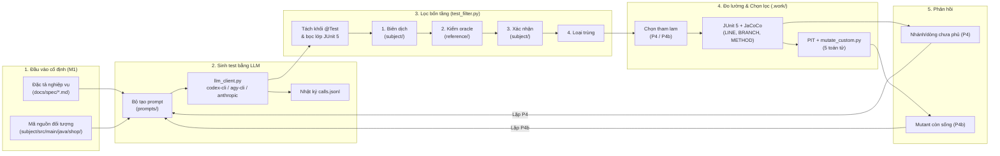
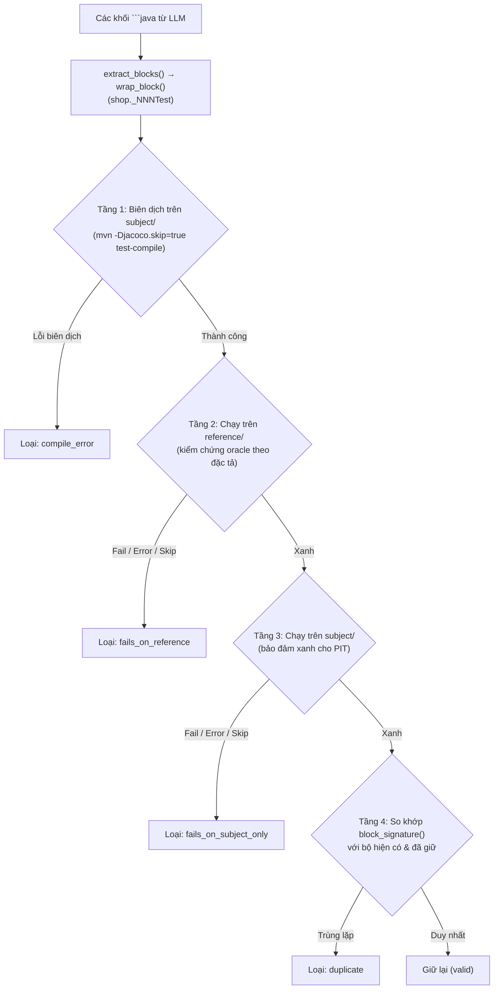

# Chương 3. Phương pháp đề xuất

Chương này trình bày kiến trúc hệ thống và các chiến lược sinh, lọc, chọn kiểm thử bằng LLM được xây dựng trong đề tài, gồm sinh trực tiếp (P3), sinh lặp có phản hồi coverage (P4) và mở rộng phản hồi mutation (P4b). Thiết kế bám sát tài liệu kỹ thuật (`docs/thiet-ke-ky-thuat.md`), nhật ký quyết định (`docs/orchestration/decisions.md`) và các mô-đun đã cài đặt trong `tools/` cùng `experiments/scripts/`.

---

## 3.1 Kiến trúc tổng thể

Hệ thống được thiết kế theo kiến trúc đường ống khép kín gồm năm thành phần tách biệt rõ vai trò, giao tiếp thông qua các tệp cấu hình và định dạng trao đổi chuẩn hóa (JSON/XML/Java):

1. **Đầu vào cố định (đóng băng tại mốc M1):** Bao gồm bộ đặc tả nghiệp vụ chi tiết (`docs/spec/*.md`) quy định chữ ký API, tiền điều kiện, thứ tự kiểm tra ngoại lệ và giá trị biên, cùng mã nguồn chương trình đối tượng (`subject/src/main/java/shop/*.java`).
2. **Mô-đun gọi LLM và ghi nhật ký (`tools/svv/llm_client.py`):** Đóng gói việc dựng prompt từ thư mục `prompts/`, thực thi lời gọi tới mô hình ngôn ngữ (hỗ trợ ba nhà cung cấp `codex-cli`, `agy-cli`, `anthropic`) và ghi đầy đủ thông tin mỗi lượt gọi (prompt, phản hồi, thời gian, token, chi phí, lỗi) vào `results/llm-logs/<method>/run-XX/calls.jsonl`.
3. **Bộ tách khối và lọc kiểm chứng bốn tầng (`tools/svv/test_blocks.py`, `tools/svv/test_filter.py`):** Phân tách phản hồi của LLM thành từng ca kiểm thử độc lập, bọc thành lớp JUnit 5 hoàn chỉnh và kiểm chứng lần lượt qua biên dịch trên `subject/`, chạy xác thực oracle trên chương trình tham chiếu độc lập `reference/`, chạy xác nhận trên `subject/` và loại trùng lặp.
4. **Hạ tầng đo lường cô lập (`experiments/scripts/measure.py`, `tools/mutate_custom.py`):** Thực thi bộ kiểm thử trong thư mục tạm `.work/` (không bao giờ ghi bẩn vào `subject/src/test/java/`), đo độ bao phủ bằng JaCoCo (`tools/svv/jacoco.py`) và kiểm thử đột biến bằng PIT kết hợp đột biến mã nguồn (`tools/svv/pit.py`, `tools/svv/custom_mutation.py`), xuất kết quả đã kiểm hợp lệ lược đồ JSON (`experiments/schema/run-result.schema.json`).
5. **Bộ trích xuất phản hồi và chọn test tham lam (cho P4 và P4b):** Đọc danh sách dòng/nhánh chưa phủ (từ JaCoCo) hoặc danh sách mutant còn sống (từ PIT và `mutate_custom.py`), tạo ngữ cảnh phản hồi gọn cho lượt nhắc tiếp theo, đồng thời chỉ giữ lại những ca kiểm thử thực sự đóng góp tăng coverage hoặc tiêu diệt thêm mutant.

Hình 3.1 (lưu riêng tại [figures/kien-truc-tong-the.md](figures/kien-truc-tong-the.md)) minh họa luồng xử lý tổng thể của hệ thống.



### Quy ước định dạng khối test độc lập

Để có thể lọc, đo đóng góp và đếm chính xác ở mức từng ca kiểm thử mà không cần sửa tay mã do LLM sinh (thiết kế 6.2, `tools/svv/test_blocks.py`), hệ thống yêu cầu LLM trả về mỗi ca kiểm thử trong một khối mã ```` ```java ```` riêng biệt, chứa **duy nhất một phương thức `@Test` hoặc `@ParameterizedTest` tự chứa** (không dùng hàm phụ, không dùng trường lớp dùng chung, không phụ thuộc đồng hồ hệ thống). Hàm `extract_blocks()` loại bỏ khai báo `package`, gom các lệnh `import` riêng nếu có, gỡ vỏ lớp ngoài nếu LLM vô tình bọc thêm lớp, kiểm tra đúng một annotation kiểm thử ở mức ngoài cùng (`_count_top_level_test_annotations == 1`), sau đó `wrap_block()` bọc mỗi khối thành một tệp nguồn riêng `shop.<Prefix>_NNNTest.java` kèm tập `STANDARD_IMPORTS` chuẩn (JUnit Jupiter, Assertions, JUnit Params, `java.time.*`, `java.util.*`).

---

## 3.2 Sinh test trực tiếp (P3 – Direct LLM Generation)

Chiến lược **P3 (`p3-direct-llm`)** đại diện cho cách sử dụng LLM cơ bản nhất không có vòng phản hồi thực thi, đóng vai trò đối chứng trực tiếp cho P4 và P4b. Tại thời điểm soạn thảo báo cáo này, mã nguồn `tools/generate_p3.py` chưa được hợp nhất vào nhánh hiện tại; quy trình dưới đây được mô tả theo thiết kế kỹ thuật (mục 6, 6.2) và đặc tả triển khai (`docs/orchestration/tasks/T10-p3-direct-llm.md`) `[CHỜ: tools/generate_p3.py]`.

Quy trình thực hiện cho mỗi lần chạy `run-XX` gồm bốn bước:

1. **Dựng prompt một lượt cố định:** Ghép toàn bộ tài liệu đặc tả nghiệp vụ trong `docs/spec/` và toàn bộ mã nguồn các tệp trong `subject/src/main/java/shop/*.java` theo thứ tự xác định vào mẫu prompt tại `prompts/direct/`. Prompt yêu cầu LLM viết các khối JUnit 5 phủ tối đa câu lệnh và nhánh, lấy **đặc tả làm chuẩn oracle** (nếu mã nguồn và đặc tả khác nhau thì tuân theo đặc tả), tuân thủ định dạng khối độc lập của `test_blocks.py` và không gọi công cụ ngoài. Không ấn định trước số lượng ca kiểm thử để đánh giá hành vi tự nhiên của LLM.
2. **Gọi LLM đúng một lần:** Gọi `llm_client.complete(..., method="p3-direct-llm", run=N, purpose="direct")` với toàn bộ ngữ cảnh nằm gọn trong prompt; lưu toàn bộ dữ liệu lời gọi vào `results/llm-logs/p3-direct-llm/run-XX/calls.jsonl`.
3. **Tách khối và lọc kiểm chứng tự động:** Trích danh sách khối bằng `extract_blocks()` và đưa qua `filter_tests()` (`tools/svv/test_filter.py`) để lọc bốn tầng mà **tuyệt đối không sửa tay** mã do LLM sinh ra.
4. **Xuất bộ test và siêu dữ liệu:** Ghi các khối hợp lệ thành các tệp `.java` riêng tại `test-suites/p3-direct-llm/run-XX/` cùng tệp `generation.json` chứa thời gian sinh, số liệu token, mã băm SHA-256 của mẫu prompt và thống kê bộ lọc (`generated`, `compiled`, `passed_reference`, `valid`, `compile_rate`, `oracle_rate`, danh sách `dropped`).

---

## 3.3 Sinh test có phản hồi coverage (P4) và phản hồi mutation (P4b)

### Thiết kế ghép cặp và thí nghiệm bóc tách

Theo quyết định D-003 và mục 6.1 của `docs/thiet-ke-ky-thuat.md`, đề tài áp dụng **thiết kế ghép cặp (paired design)** giữa P3, P4 và P4b cho từng chỉ số lần chạy `run-XX` ($XX \in \{01, \dots, 10\}$):

- **P4 (`p4-coverage-guided`)** khởi đầu từ chính bộ kiểm thử đã giữ lại của **P3 `run-XX`** thay vì sinh lại bộ ban đầu mới. Nhờ cố định điểm xuất phát, mọi thay đổi về độ bao phủ hay điểm đột biến từ P3 sang P4 phản ánh trực tiếp tác dụng của vòng lặp phản hồi coverage (trả lời RQ2 và RQ4).
- **P4b (`p4b-mutation-feedback`)** khởi đầu từ bộ kiểm thử cuối của **P4 `run-XX`** rồi chạy tiếp vòng lặp phản hồi mutation. Đây là thí nghiệm bóc tách (ablation study) giúp đo riêng đóng góp gia tăng của phản hồi đột biến sau khi độ bao phủ nhánh đã được tối ưu.
- **Quy ước cộng dồn chi phí và thời gian:** Thời gian sinh (`generation_s`), số lượt gọi và lượng token báo cáo cho P4 là tổng của P3 cộng phần phản hồi P4; tương tự, báo cáo của P4b là tổng cộng dồn từ P3 qua P4 và phần P4b, đồng thời lưu tách riêng phần phát sinh thêm của từng giai đoạn trong `generation.json`.

Luồng kế thừa và vòng lặp được minh họa ở Hình 3.2 ([figures/vong-lap-p4-p4b.md](figures/vong-lap-p4-p4b.md)).

> **Lưu ý về nguồn mã giả:** Tại thời điểm biên soạn Chương 3, tệp `tools/generate_p4.py` chưa có mặt trên nhánh làm việc hiện tại. Do đó, Thuật toán 1 và Thuật toán 2 dưới đây được trình bày bám sát mục 6.1 của `docs/thiet-ke-ky-thuat.md`, quyết định D-020 và đặc tả `docs/orchestration/tasks/T11-p4-coverage-guided.md` `[CHỜ: tools/generate_p4.py]`.

### Thuật toán 1: Sinh test có phản hồi coverage (P4)

```text
Thuật toán 1: Coverage-guided LLM Test Generation (P4)
Đầu vào:
  - S_P3: bộ test hợp lệ của P3 run-XX (cùng thời gian & token nền của P3)
  - Spec, Source: đặc tả docs/spec/ và mã nguồn subject/src/main/java/shop/
  - Cấu hình p4: max_iterations (M), target_branch_coverage (B_target),
                 token_budget (T_max), stop_if_no_gain_iterations (K_stall)
Đầu ra:
  - S: bộ test cuối cùng tại test-suites/p4-coverage-guided/run-XX/
  - iterations: lịch sử tiến triển qua từng vòng và generation.json

1:  S ← bản sao của S_P3
2:  used_tokens ← 0;  no_gain_streak ← 0;  iterations ← []
3:  cov ← đo_coverage_JaCoCo(S)                    // chế độ không mutation
4:  ghi_nhận(iterations, i=0, cov, kept_tests=|S|, tokens=0)
5:  for i ← 1 to M do
6:      if cov.branch_pct >= B_target then
7:          dừng("reached_target_branch_coverage")
8:      if used_tokens >= T_max then
9:          dừng("token_budget_exceeded")
10:     if no_gain_streak >= K_stall then
11:         dừng("no_gain_streak")
12:
13:     ctx ← trích_ngữ_cảnh_chưa_phủ(cov.uncovered, Source)
14:         // gồm dòng chưa phủ, nhánh thiếu (missed/covered), tên phương thức
15:         // và các dòng mã nguồn lân cận gom theo phương thức
16:     existing_names ← danh_sách_tên_phương_thức(S)
17:     prompt ← dựng_prompt_coverage(Spec, Source, existing_names, ctx)
18:
19:     resp ← llm_client.complete(prompt, method="p4-coverage-guided",
20:                                run=XX, purpose=f"iter-{i}")
21:     iter_tokens ← resp.input_tokens + resp.output_tokens
22:     used_tokens ← used_tokens + iter_tokens
23:
24:     blocks ← extract_blocks(resp.text)
25:     filt ← filter_tests(blocks, existing=S)    // lọc 4 tầng (mục 3.6)
26:     selected ← chọn_tham_lam_tăng_coverage(filt.kept, S)
27:
28:     if selected không rỗng then
29:         S ← S ∪ selected
30:         cov_new ← đo_coverage_JaCoCo(S)
31:         if (cov_new.statement.covered > cov.statement.covered)
32:            hoặc (cov_new.branch.covered > cov.branch.covered) then
33:             no_gain_streak ← 0
34:         else
35:             no_gain_streak ← no_gain_streak + 1
36:         cov ← cov_new
37:     else
38:         no_gain_streak ← no_gain_streak + 1
39:
40:     ghi_nhận(iterations, i, cov, kept_tests=|selected|, tokens=iter_tokens,
41:              generated=filt.generated, valid=filt.valid, dropped=filt.dropped)
42: end for
43: xuất_bộ_test(S) và generation.json (cộng dồn chi phí từ P3 + phần P4)
44: return S, iterations
```

### Thuật toán 2: Mở rộng phản hồi mutation (P4b)

```text
Thuật toán 2: Mutation-feedback LLM Test Generation (P4b)
Đầu vào:
  - S_P4: bộ test cuối của P4 run-XX (cùng thời gian & token cộng dồn của P4)
  - Spec, Source: đặc tả và mã nguồn subject/
  - Cấu hình p4b: max_iterations (M_b), target_mutation_score (MS_target),
                  token_budget (T_max_b), stop_if_no_gain_iterations (K_stall_b)
Đầu ra:
  - S: bộ test cuối cùng tại test-suites/p4b-mutation-feedback/run-XX/
  - iterations: lịch sử từng vòng và generation.json

1:  S ← bản sao của S_P4
2:  used_tokens ← 0;  no_gain_streak ← 0;  iterations ← []
3:  res ← đo_coverage_và_mutation(S)               // JaCoCo + PIT + mutate_custom
4:  ghi_nhận(iterations, i=0, res.cov, res.mut, kept_tests=|S|, tokens=0)
5:  for i ← 1 to M_b do
6:      if res.mut.score >= MS_target then
7:          dừng("reached_target_mutation_score")
8:      if used_tokens >= T_max_b then
9:          dừng("token_budget_exceeded")
10:     if no_gain_streak >= K_stall_b then
11:         dừng("no_gain_streak")
12:
13:     alive ← lọc_mutant_còn_sống(res.mut)       // trạng thái SURVIVED và NO_COVERAGE
14:     if alive rỗng then
15:         dừng("no_surviving_mutants")
16:
17:     ctx ← trích_ngữ_cảnh_mutant(alive, Source)
18:         // vị trí (lớp, phương thức, dòng), toán tử, mô tả PIT
19:         // hoặc đoạn mã gốc -> đoạn mã đột biến (với mutate_custom)
20:     existing_names ← danh_sách_tên_phương_thức(S)
21:     prompt ← dựng_prompt_mutation(Spec, Source, existing_names, ctx)
22:
23:     resp ← llm_client.complete(prompt, method="p4b-mutation-feedback",
24:                                run=XX, purpose=f"mut-iter-{i}")
25:     iter_tokens ← resp.input_tokens + resp.output_tokens
26:     used_tokens ← used_tokens + iter_tokens
27:
28:     blocks ← extract_blocks(resp.text)
29:     filt ← filter_tests(blocks, existing=S)
30:     selected ← chọn_tham_lam_diệt_mutant(filt.kept, S, alive)
31:
32:     if selected không rỗng then
33:         S ← S ∪ selected
34:         res_new ← đo_coverage_và_mutation(S)
35:         if res_new.mut.killed > res.mut.killed then
36:             no_gain_streak ← 0
37:         else
38:             no_gain_streak ← no_gain_streak + 1
39:         res ← res_new
40:     else
41:         no_gain_streak ← no_gain_streak + 1
42:
43:     ghi_nhận(iterations, i, res.cov, res.mut, kept_tests=|selected|, tokens=iter_tokens)
44: end for
45: xuất_bộ_test(S) và generation.json (cộng dồn từ P3 + P4 + phần P4b)
46: return S, iterations
```

Ngoài chế độ thực nghiệm chuẩn, thiết kế quy định chế độ trình diễn nhanh (`--demo`, dùng `demo_max_iterations = 2` trong `experiments/config/default.yaml`) xuất kết quả vào thư mục tạm `.work/demo/` để phục vụ trình diễn trực tiếp mà không ghi đè bộ thực nghiệm chính thức.

---

## 3.4 Thiết kế prompt

Bộ prompt được tổ chức tách biệt theo ba chiến lược trong thư mục `prompts/`:

- `prompts/direct/`: Mẫu prompt sinh một lượt cho P3, dự kiến gồm vai trò hệ thống, quy tắc định dạng khối JUnit 5, đặc tả (`{{SPEC}}`), API đóng băng (`{{API}}`) và mã nguồn (`{{SOURCE}}`). `[CHỜ: prompts/direct/]`
- `prompts/coverage-guided/`: Mẫu prompt phản hồi độ bao phủ cho P4, bổ sung danh sách tên ca kiểm thử hiện có để tránh trùng lặp và khối ngữ cảnh dòng/nhánh chưa phủ gom theo phương thức. `[CHỜ: prompts/coverage-guided/]`
- `prompts/mutation-feedback/`: Mẫu prompt phản hồi đột biến cho P4b, bổ sung danh sách mutant còn sống (`SURVIVED`, `NO_COVERAGE`) kèm toán tử, vị trí dòng và mô tả biến đổi. `[CHỜ: prompts/mutation-feedback/]`

Tại thời điểm viết báo cáo này, cả ba thư mục con trong `prompts/` mới ở trạng thái khởi tạo (`.gitkeep`) và đang được hoàn thiện ở các gói T10, T11 và T12. Khi các mẫu prompt được hợp nhất, mục này sẽ được bổ sung chi tiết cấu trúc từng phần, danh sách biến thay thế, độ dài ký tự và mã băm SHA-256 cố định dùng trong thực nghiệm.

---

## 3.5 Thực thi và cơ chế phản hồi

### Thực thi cô lập không làm bẩn mã nguồn đối tượng

Mọi thao tác biên dịch, chạy kiểm thử và đo lường đều thông qua `tools/svv/workdir.py` và `experiments/scripts/measure.py` (thiết kế 2.2). Với mỗi lần đo, hệ thống sao chép `subject/` (hoặc `reference/`, bỏ thư mục `target/`) sang một thư mục tạm duy nhất `.work/<id>/`, chép bộ kiểm thử vào `.work/<id>/src/test/java/`, chạy Maven ở chế độ batch (`mvn -B`), đọc kết quả XML/HTML rồi xóa thư mục tạm. Thư mục `subject/src/test/java/` luôn được giữ trống, bảo đảm không có hiện tượng rò rỉ lớp kiểm thử cũ giữa các lần đo và cho phép đánh giá song song nhiều mutant.

### Giao tiếp LLM và ghi nhật ký (`tools/svv/llm_client.py`)

Hàm `complete()` trong `tools/svv/llm_client.py` trừu tượng hóa việc gọi LLM qua ba nhà cung cấp cấu hình được trong `experiments/config/default.yaml`:

1. **`codex-cli` (mặc định của thực nghiệm — D-005):** Gọi `codex exec --skip-git-repo-check --ephemeral --json -s read-only -c model_reasoning_effort=<effort> -m <model> -`, truyền prompt qua `stdin` và phân tích luồng sự kiện JSONL (`item.completed`, `turn.completed`) để lấy nội dung phản hồi, `input_tokens`, `cached_input_tokens`, `output_tokens`, `reasoning_output_tokens` và đếm `tool_events`.
2. **`agy-cli` (dự phòng khi codex hết hạn mức theo cửa sổ thời gian — D-015):** Gọi `agy -p <prompt> --model <model> --output-format json --print-timeout <t>s`; nếu độ dài dòng lệnh vượt ngưỡng 32.767 ký tự của Windows (`WINDOWS_CMD_LIMIT`), hệ thống tự động chuyển sang giao thức `--input-format stream-json --output-format stream-json` qua `stdin`.
3. **`anthropic` (tùy chọn khi có khóa API trong `.env`):** Gọi trực tiếp Messages API thông qua thư viện `anthropic`, truyền mức suy luận qua `output_config={"effort": ...}`.

Mọi lời gọi CLI đều chạy trong một thư mục rỗng mới dưới `.work/llm-scratch/<prefix><uuid>` (và dọn dẹp trong khối `finally`), giúp ngăn mô hình đọc tệp ngoài ý muốn và khắc phục lỗi phân quyền `[WinError 5]` tại `%TEMP%` trên Windows đã phát hiện ở Spike S3 (`experiments/spikes/s3/KET-QUA.md`). Toàn bộ siêu dữ liệu lời gọi được ghi nối tiếp dạng JSON Lines vào `results/llm-logs/<method>/run-XX/calls.jsonl`; mọi khóa bí mật (nếu dùng `anthropic`) đều được che bằng `[REDACTED]`.

### Cơ chế trích xuất phản hồi

- **Phản hồi coverage (`tools/svv/jacoco.py`):** Hàm `parse_jacoco()` đọc `target/site/jacoco/jacoco.xml` giới hạn đúng trong `<package name="shop">`, ánh xạ từng số dòng nguồn sang `(class, method, line)` dựa trên dòng bắt đầu của phương thức gần nhất phía trên. Đầu ra liệt kê chính xác hai tập: `uncovered.lines` (các dòng có `mi > 0` và `ci == 0`) và `uncovered.branches` (các dòng có `mb > 0`, ghi rõ số nhánh bỏ sót `missed` và đã phủ `covered`). Chi tiết cách cắt đoạn mã nguồn ngữ cảnh quanh dòng chưa phủ chờ hoàn thiện tại `[CHỜ: tools/svv/feedback.py]`.
- **Phản hồi mutation (`tools/svv/pit.py`, `tools/svv/custom_mutation.py`):** Kết hợp danh sách mutant từ `target/pit-reports/mutations.xml` (PIT) và `custom-mutations.json` (`mutate_custom.py`). Các mutant có trạng thái `SURVIVED` hoặc `NO_COVERAGE` (không thuộc danh sách mutant tương đương) cung cấp thông tin lớp, phương thức, dòng, toán tử và mô tả phép biến đổi (`description` của PIT hoặc cặp `original -> mutated` của mutant mã nguồn) cho vòng lặp P4b `[CHỜ: tools/svv/feedback.py]`.

### Hạn chế thiết kế đã biết về tầng gọi LLM qua CLI

Do môi trường thực nghiệm không sử dụng khóa API trả phí trực tiếp mà khai thác hạn mức sẵn có qua công cụ dòng lệnh (D-005, D-015), hệ thống mang hai hạn chế kỹ thuật cần ghi nhận minh bạch:

1. **Chi phí token nền (baseline context overhead) của CLI:** Ngay cả với một prompt kiểm khói rất ngắn, bộ đếm `input_tokens` do CLI báo cáo đã bao gồm toàn bộ ngữ cảnh hệ thống và mô tả công cụ mặc định của CLI — đo thực tế tại Spike S3 vào khoảng **22.000 token** đối với `codex-cli` và **15.566 token** ($\approx$ 15,5k token) đối với `agy-cli` (`experiments/spikes/s3/KET-QUA.md`, D-020). Điều này làm tăng tổng `input_tokens` và là lý do phải nâng `token_budget` của P4 lên 400.000 token (D-020).
2. **Sự khác biệt cơ chế điều khiển mức suy luận:** Mô hình đời mới không nhận tham số `temperature` mà dùng `effort` (thiết kế 1.2); riêng `agy-cli` không nhận tham số `effort` rời mà mã hóa trực tiếp mức suy luận trong tên model (`experiments/spikes/s3/KET-QUA.md`). Vì vậy, khi phân tích RQ6 ở Chương 5 cần phân tách rõ phần token nền CLI khỏi phần nội dung prompt thực tế.

---

## 3.6 Lọc và chọn test

### Chương trình tham chiếu độc lập (`reference/`) và chứng minh tính đúng oracle

Để khắc phục hạn chế "oracle hồi quy hợp thức hóa lỗi" đã phân tích ở mục 2.5, đề tài cài đặt một phiên bản độc lập thứ hai của module `shop` tại thư mục `reference/` (thiết kế 4.1). Tính độc lập được bảo đảm bằng ba biện pháp quy trình (D-006):

1. `reference/` được biên soạn **chỉ từ bộ đặc tả đóng băng `docs/spec/` và khung chữ ký `api.md`**, trong một worktree riêng không chứa mã cài đặt `subject/`.
2. `reference/` được cài đặt bởi một họ mô hình khác (`agy` / Gemini) so với phiên cài đặt `subject/` và bộ test chuẩn P1 (`codex` / GPT), giảm thiểu nguy cơ hai phiên bản cùng lặp lại một cách hiểu sai giống nhau.
3. Trước khi tiến hành đo lường các phương pháp khác, toàn bộ bộ kiểm thử thủ công P1 (181 ca kiểm thử truy vết đủ 32 nhóm nhánh trong `docs/spec/branches.md`) đã được thực thi trên cả `subject/` và `reference/` và chạy xanh hoàn toàn trên cả hai bản (`docs/orchestration/progress.md`), xác nhận tính tương đương hành vi `subject ≡ reference` theo yêu cầu thiết kế 4.3.

### Quy trình lọc bốn tầng (`tools/svv/test_filter.py`)

Mọi khối kiểm thử ứng viên do LLM sinh ra trong P3, P4 và P4b đều đi qua hàm `filter_tests()` thực thi đúng bốn quy tắc lọc của thiết kế 4.2 (minh họa ở Hình 3.3, lưu riêng tại [figures/quy-trinh-loc-va-do.md](figures/quy-trinh-loc-va-do.md)):



Cơ chế kỹ thuật của từng tầng trong `tools/svv/test_filter.py`:

1. **Tầng 1 — Biên dịch hàng loạt có cô lập lỗi (`_compile_batch`):** Toàn bộ ứng viên được biên dịch chung một lượt trên `subject/` bằng `mvn -B -Djacoco.skip=true test-compile` để tiết kiệm thời gian khởi động JVM. Nếu thất bại, hàm trích tên tệp `.java` lỗi từ log `javac` và loại riêng các tệp hỏng với lý do `compile_error` rồi biên dịch lại phần còn lại; trường hợp log không nêu rõ tên tệp, thuật toán tự động **chia đôi nhị phân (bisect)** tập ứng viên để cô lập chính xác khối lỗi.
2. **Tầng 2 — Xác thực oracle trên `reference/`:** Chạy toàn bộ khối đã biên dịch trên `reference/` bằng Surefire (`-Dmaven.test.failure.ignore=true`) và đọc từng tệp `TEST-shop.<Class>.xml`. Khối chỉ vượt qua khi `tests >= 1` và `failures == errors == skipped == 0`; ngược lại bị loại với lý do `fails_on_reference` (chứng minh oracle sai so với đặc tả).
3. **Tầng 3 — Xác nhận trên `subject/`:** Chạy các khối đã vượt tầng 2 lên `subject/`. Khối thất bại bị loại với lý do `fails_on_subject_only` (tín hiệu cảnh báo bất đồng giữa hai bản cài đặt cần kiểm tra lại đặc tả).
4. **Tầng 4 — Loại trùng lặp chuẩn hóa (`block_signature`):** Chuẩn hóa chữ ký thân phương thức bằng cách bỏ tên phương thức kiểm thử, xóa chú thích Java (`//`, `/* */`), gộp khoảng trắng ngoài chuỗi/ký tự literal, đồng thời giữ lại các annotation nguồn dữ liệu của `@ParameterizedTest` (`@ValueSource`, `@CsvSource`, `@EnumSource`, ...) và danh sách tham số (`tools/svv/test_blocks.py`). Khối trùng chữ ký với tập `existing` hoặc với một khối đã giữ trước đó bị loại với lý do `duplicate`.

Từ thống kê của bốn tầng lọc, hệ thống tính hai chỉ số chất lượng đầu ra của LLM: $\text{compile\_rate} = \text{compiled} / \text{generated}$ và $\text{oracle\_rate} = \text{passed\_reference} / \text{compiled}$.

### Chọn test tham lam (Greedy Selection)

Trong các vòng lặp phản hồi của P4 và P4b, sau khi các ứng viên vượt qua bộ lọc bốn tầng, hệ thống áp dụng bước **chọn test tham lam (greedy selection)** nhằm tránh làm phình to bộ kiểm thử bằng những ca hợp lệ nhưng vô ích (không đem lại thông tin kiểm thử mới):

- **Đối với P4:** Chỉ giữ lại các ứng viên thực sự làm tăng tập dòng hoặc nhánh đã phủ so với bộ hiện tại $S$, ưu tiên chọn lần lượt ứng viên có số dòng và nhánh mới phủ cao nhất cho tới khi không còn ứng viên nào đóng góp thêm.
- **Đối với P4b:** Chỉ giữ lại các ứng viên tiêu diệt thêm ít nhất một mutant thuộc tập còn sống (`SURVIVED` hoặc `NO_COVERAGE`), ưu tiên chọn tham lam theo số mutant diệt thêm.

Cài đặt cụ thể cơ chế đo đóng góp riêng của từng ứng viên (ví dụ đo cộng dồn từng ứng viên hoặc phiên JaCoCo theo từng test) và phân tích độ phức tạp thời gian thực tế sẽ được cập nhật khi hợp nhất mô-đun chọn lọc `[CHỜ: tools/svv/selection.py]`.
