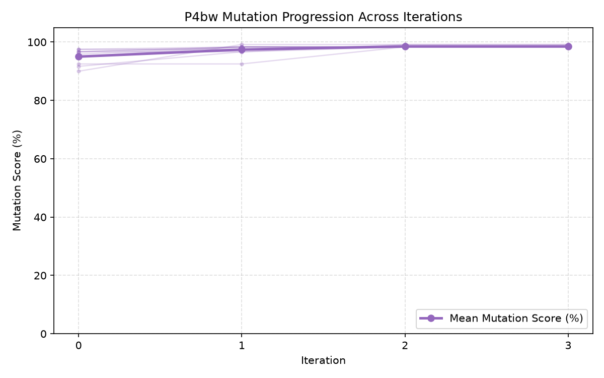

# Chương 5. Kết quả và thảo luận

Trên module giỏ hàng và thanh toán `shop`, hai bộ sinh trực tiếp P3 và P3r đã phủ đủ các nhánh và diệt hết các mutant có thể phân biệt trong tập thực nghiệm. Chỉ chuỗi dùng LLM yếu hơn còn đủ khoảng trống để quan sát riêng tác dụng của hai loại phản hồi. Ở chuỗi này, nhắm vào nhánh chưa phủ làm tăng coverage ở hai lần chạy, còn nhắm vào mutant còn sống làm tăng mutation score ở cả mười lần. Các bảng dưới đây dùng dữ liệu đã chốt ở `m5-data-frozen`. [Bảng tổng hợp](../../results/comparison/summary.md) · [Đối chiếu theo lần chạy](../../results/comparison/coverage-before-after-weak-llm.md)

## 5.1 Kết quả sinh test

P1 là bộ viết tay, P2 sinh ngẫu nhiên với oracle lấy từ chương trình tham chiếu. Ba chuỗi LLM cùng đi qua các bước sinh trực tiếp → phản hồi coverage → phản hồi mutation. Chuỗi P3 → P4 → P4b dùng `gpt-6.2-astra` với đầy đủ mã nguồn và đặc tả. P3r → P4r → P4br dùng cùng mô hình, chỉ cung cấp đặc tả và API ở bước sinh trực tiếp. P3w → P4w → P4bw trở lại ngữ cảnh đầy đủ và dùng `gemini-3.8-flash-low`. Trong mỗi chuỗi, giai đoạn sau kế thừa bộ test của giai đoạn trước có cùng mã lần chạy. [D-024 và D-025](../orchestration/decisions.md) · [Dữ liệu từng lần chạy](../../results/comparison/raw/)

**Bảng 5.1. Số test và chất lượng oracle.** Hai cột số test ghi trung vị theo lần chạy. Tỷ lệ biên dịch là số biên dịch được chia số sinh ra. Tỷ lệ oracle đúng là số chạy qua trên `reference/` chia số biên dịch được, trình bày bằng khoảng nhỏ nhất–lớn nhất trên thang 0–1. Một giá trị đơn nghĩa là mọi lần có cùng kết quả. Nguồn [summary.md](../../results/comparison/summary.md).

| Phương pháp | n | Sinh ra | Hợp lệ | Tỷ lệ biên dịch | Tỷ lệ oracle đúng |
|---|---:|---:|---:|---:|---:|
| P1 | 1 | 181 | 181 | 1 | — |
| P2 | 10 | 100 | 100 | 1 | — |
| P3 | 10 | 28 | 28 | 1 | 1 |
| P4 | 10 | 28 | 28 | 1 | 1 |
| P4b | 10 | 28 | 28 | 1 | 1 |
| P3r | 10 | 31 | 31 | 1 | 1 |
| P4r | 10 | 31 | 31 | 1 | 1 |
| P4br | 10 | 31 | 31 | 1 | 1 |
| P3w | 10 | 53 | 53 | 1 | 0,9839–1 |
| P4w | 10 | 53 | 53 | 1 | 0,9841–1 |
| P4bw | 10 | 75 | 74,5 | 1 | 0,9884–1 |

Dấu “—” ở P1 và P2 ứng với `n = 0` riêng cho chỉ số oracle trong bảng tổng hợp. Với LLM, số test hợp lệ đếm các khối qua bộ lọc. Một khối tham số hóa có thể chạy nhiều ca JUnit, và ở bước phản hồi, chỉ những khối đem lại mức tăng mới được thêm vào bộ cuối. Ví dụ, P3w `run-10` có 62 khối biên dịch được, 61 khối qua tham chiếu. P4bw `run-01` ghi 113 khối hợp lệ tích lũy nhưng số khối thêm vào bộ P4w qua ba vòng lần lượt là 10, 0 và 0. Sự khác nhau về đơn vị đếm cũng ảnh hưởng đến so sánh kích thước bộ test với P1. [summary.md](../../results/comparison/summary.md) · [P3w run-10](../../results/comparison/raw/p3w-weak-llm/run-10.json) · [P4bw run-01](../../results/comparison/raw/p4bw-mutation-feedback/run-01.json) · [iterations.csv](../../results/comparison/iterations.csv)

**Bảng 5.2. Tài nguyên theo phương pháp.** Các cột token và thời gian ghi trung vị. Cột lượt gọi ghi nhỏ nhất–lớn nhất. Token, lượt gọi và thời gian sinh cộng dồn từ bộ nền đến hết giai đoạn đang xét. Thời gian thực thi là `execution_s` của lần đo bộ cuối, gồm cả kiểm thử đột biến. Nguồn [summary.md](../../results/comparison/summary.md) và trường `llm.calls` trong [raw](../../results/comparison/raw/).

| Phương pháp | Lượt gọi | Token vào | Token ra | Sinh (s) | Thực thi (s) |
|---|---:|---:|---:|---:|---:|
| P1 | 0 | 0 | 0 | 0 | 95,5742 |
| P2 | 0 | 0 | 0 | 0,1507 | 90,3139 |
| P3 | 1 | 40086 | 9766,5 | 219,5244 | 98,2700 |
| P4 | 1 | 40086 | 9766,5 | 224,2968 | 91,6965 |
| P4b | 1 | 40086 | 9766,5 | 315,4323 | 90,8997 |
| P3r | 1 | 36658 | 10615,5 | 232,2803 | 92,8762 |
| P4r | 1 | 36658 | 10615,5 | 237,5025 | 92,3127 |
| P4br | 1 | 36658 | 10615,5 | 332,2954 | 92,4562 |
| P3w | 1 | 40742,5 | 11377,5 | 194,7079 | 90,4126 |
| P4w | 1–5 | 40758,5 | 11710 | 213,7384 | 91,5186 |
| P4bw | 4–8 | 151247 | 14877,5 | 978,9383 | 92,6309 |

Giá trị 0 ở cột thời gian sinh của P1 là quy ước cho bộ test có sẵn. Thực nghiệm không đo công viết tay. Ở hai chuỗi đạt trần, việc đo bộ nền để kiểm tra điều kiện dừng vẫn mất thời gian dù số token giữ nguyên. Chi phí USD của các phương pháp LLM để trống (`cost_usd` có `n = 0`), nên các so sánh chi phí dưới đây dùng token, lượt gọi và giây. [summary.md](../../results/comparison/summary.md)

## 5.2 Độ bao phủ và các nhánh còn thiếu

**Bảng 5.3. Độ bao phủ theo phương pháp (%).** Mỗi ô ghi trung vị và, khi có biến thiên, khoảng nhỏ nhất–lớn nhất trong ngoặc. JaCoCo đếm 235 dòng thực thi (`LINE`, đại diện cho statement), 174 nhánh (`BRANCH`) và 55 phương thức (`METHOD`). Các phương pháp trên cùng một hàng có cùng kết quả riêng ở từng phương pháp. Nguồn [summary.md](../../results/comparison/summary.md) và [bộ đếm JaCoCo trong raw](../../results/comparison/raw/p1-manual/run-01.json).

| Phương pháp | Dòng | Nhánh | Phương thức |
|---|---:|---:|---:|
| P1 | 100 | 100 | 100 |
| P2 | 91,7021 (86,8085–94,4681) | 77,0115 (71,2644–81,6092) | 100 |
| P3, P4, P4b | 100 | 100 | 100 |
| P3r, P4r, P4br | 100 | 100 | 100 |
| P3w | 100 (99,5745–100) | 100 (97,1264–100) | 100 |
| P4w, P4bw | 100 | 100 (99,4253–100) | 100 |

**Bảng 5.4. Độ bao phủ trước và sau phản hồi coverage theo cùng lần chạy.** Các ô ghi số phần tử đã phủ trước → sau. Chỉ gộp những lần có bộ đếm giống nhau. Nguồn [coverage-before-after.md](../../results/comparison/coverage-before-after.md), [coverage-before-after-reduced.md](../../results/comparison/coverage-before-after-reduced.md), [coverage-before-after-weak-llm.md](../../results/comparison/coverage-before-after-weak-llm.md) và [bộ đếm trong raw](../../results/comparison/raw/).

| Chuyển tiếp | Lần chạy | Dòng / 235 | Nhánh / 174 | Phương thức / 55 |
|---|---|---:|---:|---:|
| P3 → P4 | 01–10 | 235 → 235 | 174 → 174 | 55 → 55 |
| P3r → P4r | 01–10 | 235 → 235 | 174 → 174 | 55 → 55 |
| P3w → P4w | 01 | 234 → 235 | 169 → 173 | 55 → 55 |
| P3w → P4w | 02–09 | 235 → 235 | 174 → 174 | 55 → 55 |
| P3w → P4w | 10 | 235 → 235 | 173 → 174 | 55 → 55 |

P2 gọi được mọi phương thức nhưng chỉ phủ 124–142 nhánh. Cả mười lần đều còn nhánh thiếu trong constructor `Order`, ở phép tính trần giảm giá và ở `Cart.updateQuantity` dòng 33. Luồng đặt đơn thông thường dựng `Order` từ giỏ đã kiểm tra, nên khó đưa danh sách sai hay tổng tiền bất nhất vào constructor qua luồng đó. Muốn đi qua nhánh xóa của `updateQuantity`, bộ sinh phải chọn đúng ID đã có rồi cập nhật số lượng về 0. Các điều kiện về trạng thái và thứ tự lời gọi giải thích vì sao chỉ tăng số đầu vào ngẫu nhiên có thể vẫn bỏ sót cùng một vị trí. [Các lần chạy P2, trường uncovered](../../results/comparison/raw/p2-random/) · [Đặc tả các tình huống](../spec/branches.md)

Ở P3w `run-01`, năm nhánh thiếu nằm tại phép chặn trần giảm giá, ba vị trí kiểm tra dữ liệu trong constructor `Order` và kiểm tra trạng thái khi hủy đơn. P4w giữ thêm lần lượt 3 rồi 1 khối, sau đó hai vòng liên tiếp giữ 0 khối và dừng. Nhánh còn thiếu thuộc biểu thức `items == null || items.isEmpty()` ở `Order` dòng 21. JaCoCo ghi 3 nhánh đã phủ và 1 nhánh thiếu. Bộ test có cả danh sách hợp lệ và danh sách rỗng, nên đường còn thiếu là trường hợp truyền chính tham chiếu `null`; danh sách rỗng vẫn buộc Java đánh giá vế phải. Ở `run-10`, một khối mới đủ để phủ nhánh còn thiếu trong `cancelOrder`. [P3w run-01](../../results/comparison/raw/p3w-weak-llm/run-01.json) · [P4w run-01](../../results/comparison/raw/p4w-coverage-guided/run-01.json) · [Ca kiểm tra constructor](../../test-suites/p4w-coverage-guided/run-01/P3_063Test.java) · [P3w run-10](../../results/comparison/raw/p3w-weak-llm/run-10.json) · [iterations.csv](../../results/comparison/iterations.csv)

## 5.3 Kiểm thử đột biến

Mutation score bằng số mutant bị diệt chia cho số mutant sinh ra sau khi trừ mutant tương đương, rồi nhân 100. Mutant chưa được thực thi (`NO_COVERAGE`) vẫn ở mẫu số. Trong 121 mutant có một mutant tương đương, nên mẫu số chung là 120. Bảng tổng hợp đã tính lại điểm cho cả 101 bản ghi, kể cả các lần P1 và P2 mà JSON ban đầu dùng mẫu số cũ. [summary.md, phần Equivalent mutants excluded](../../results/comparison/summary.md) · [Danh sách mutant tương đương](../../results/mutation/equivalent-mutants.csv)

**Bảng 5.5. Mutation score và số mutant bị diệt theo toán tử.** Điểm là trung vị (%). Các cột còn lại là số bị diệt nhỏ nhất–lớn nhất trong một lần chạy, với mẫu số khả diệt ghi ở đầu cột. Riêng nhóm quan hệ có 28 mutant ban đầu và còn 27 sau rà soát. Cực trị ở các cột có thể thuộc các lần khác nhau. Nguồn [summary.md](../../results/comparison/summary.md) và trường `mutation.by_operator` trong [raw](../../results/comparison/raw/).

| Phương pháp | Điểm (%) | Diệt / 120 | Quan hệ / 27 | Số học / 19 | Điều kiện / 31 | Hằng boolean / 2 | Xóa lệnh / 41 |
|---|---:|---:|---:|---:|---:|---:|---:|
| P1 | 99,1667 | 119 | 26 | 19 | 31 | 2 | 41 |
| P2 | 62,5000 | 70–85 | 1–7 | 13–18 | 13–22 | 2 | 36–40 |
| P3, P4, P4b | 100 | 120 | 27 | 19 | 31 | 2 | 41 |
| P3r, P4r, P4br | 100 | 120 | 27 | 19 | 31 | 2 | 41 |
| P3w, P4w | 96,2500 | 108–117 | 17–25 | 17–19 | 28–31 | 2 | 41 |
| P4bw | 98,3333 | 118–119 | 26 | 19 | 30–31 | 2 | 41 |

**Mutant được loại.** Ở `PricingService.calculateDiscount` dòng 24, mutant PIT index 85 đổi `discount > max` thành `discount >= max`. Chỉ khi hai số bằng nhau chương trình mới đi khác nhánh, nhưng trả về `discount` hay `max` đều cho cùng số tiền. Mutant index 80 cùng dòng sửa điều kiện khác và có thể bị diệt. Với P1, mutant khả diệt còn sống nằm ở `ShippingCalculator` dòng 8, index 10. Nếu tiền hàng bằng 0 và các tham số khác hợp lệ, đặc tả cho phép tính phí, còn mutant dùng điều kiện `orderValue <= 0` sẽ ném ngoại lệ. P1 phủ cả hai phía của điều kiện với dữ liệu khác mà bỏ sót đúng giá trị biên này. [Biên bản rà soát](../../results/mutation/equivalent-review.md) · [equivalent-mutants.csv](../../results/mutation/equivalent-mutants.csv) · [Điểm P1 sau rà soát](../../results/comparison/summary.md)

**Mutant còn sống.** P2 diệt ít nhất ở nhóm quan hệ. Chẳng hạn, trong `run-01` có 2 mutant chưa được phủ và 46 mutant ở trạng thái `SURVIVED` trước khi trừ tương đương. Với nhóm sau, test đã tới vị trí đột biến nhưng dữ liệu và kết quả được kiểm tra chưa phân biệt được hai phiên bản. Điều này phù hợp với các phép so sánh chỉ đổi hành vi đúng tại biên bằng nhau. Cả hai mutant boolean đều bị diệt ngay cả ở P2, nên nhóm này không phân biệt được các phương pháp. [P2 run-01](../../results/comparison/raw/p2-random/run-01.json) · [Dữ liệu theo toán tử của P2](../../results/comparison/raw/p2-random/)

P4bw còn mutant biên `Cart.addItem` dòng 17, index 6, ở cả mười lần. Khi thêm lượng 0 cho sản phẩm mới, một kiểm tra sâu hơn ở `CartItem` vẫn có thể ném cùng kiểu ngoại lệ sau khi mutant cho qua kiểm tra đầu tiên. Trạng thái giỏ trước lời gọi vì vậy có ý nghĩa. Với ID đã có, lượng cộng dồn có thể vẫn dương và hai chương trình cho kết quả khác nhau. Ở `run-02` đến `run-09` còn thêm mutant đổi `||` thành `&&` ở `OrderService.placeOrder` dòng 23 dù coverage nhánh đã đạt 100%. Muốn phân biệt, phải chọn tổ hợp làm hai biểu thức cho kết quả khác nhau và quan sát được khác biệt, chẳng hạn qua thứ tự ngoại lệ khi đầu đơn sai và giỏ cũng sai. Hai mutant này đều bị P3 diệt. [P4bw, trường mutation.alive](../../results/comparison/raw/p4bw-mutation-feedback/) · [P3 run-01](../../results/comparison/raw/p3-direct-llm/run-01.json) · [Ca kiểm tra trạng thái giỏ](../../test-suites/p3-direct-llm/run-01/P3_012Test.java)

*Hình 5.1. Tiến triển của P4bw từ bộ nền P4w ở vòng 0. Sự cải thiện tập trung ở hai vòng đầu. Vòng thứ ba giữ nguyên điểm ở cả mười lần chạy.* Nguồn [p4bw_iterations_mutation.png](../../results/comparison/figures/p4bw_iterations_mutation.png) và [iterations.csv](../../results/comparison/iterations.csv).

## 5.4 So sánh các phương pháp

Bảng 5.6 dùng kiểm định Mann–Whitney U hai phía và độ lớn hiệu ứng Vargha–Delaney Â₁₂. Với thứ tự A so với B, Â₁₂ là xác suất một quan sát A lớn hơn một quan sát B, cộng nửa xác suất hòa. Giá trị lớn ở chỉ số thời gian nghĩa là A chậm hơn. P1 chỉ có một quan sát nên chỉ dùng để đối chiếu mô tả. [pairwise.md](../../results/comparison/pairwise.md)

**Bảng 5.6. Các so sánh liên quan trực tiếp đến hiệu quả và thời gian sinh.** Mỗi nhóm A và B đều có 10 lần chạy. Các cặp chung một hàng có cùng giá trị ở từng chỉ số được nêu. Nguồn [pairwise.md](../../results/comparison/pairwise.md).

| A so với B | Chỉ số | U | p hai phía | Â₁₂ |
|---|---|---:|---:|---:|
| P3 so với P2, P4 so với P2 | Nhánh, mutation | 100 | 0,0001 | 1 |
| P3 so với P2, P4 so với P2 | Thời gian sinh | 100 | 0,0002 | 1 |
| P4 so với P3, P4b so với P4 | Nhánh, mutation | 50 | 1 | 0,5 |
| P4r so với P3r, P4br so với P4r, P3r so với P3 | Nhánh, mutation | 50 | 1 | 0,5 |
| P3w so với P3 | Mutation | 0 | 0,0001 | 0 |
| P4w so với P3w | Nhánh | 55,5 | 0,5428 | 0,5550 |
| P4w so với P3w | Mutation | 50 | 1 | 0,5 |
| P4bw so với P4w | Nhánh | 50 | 1 | 0,5 |
| P4bw so với P4w | Mutation | 100 | 0,0001 | 1 |
| P4bw so với P4w | Thời gian sinh | 92 | 0,0017 | 0,9200 |

Ở hai chuỗi đạt trần, hai phân bố nhánh hoặc mutation cùng hằng tại 100%. Khi ấy U = 50, p = 1 và Â₁₂ = 0,5 chỉ phản ánh mọi quan sát hòa nhau. Kiểm định không có ý nghĩa phân biệt hiệu quả phản hồi trong tình huống đó và không chứng minh hai phương pháp tương đương trên chương trình khác. Ở chuỗi yếu hơn, cùng một trung vị nhánh 100% vẫn che khuất mức tăng ở `run-01` và `run-10`. Phép U so hạng giữa hai nhóm, trong khi các giai đoạn kế thừa cùng bộ nền. Vì vậy, mức tăng quan sát được phải đọc trên từng cặp cùng lần chạy ở Bảng 5.4. [pairwise.md](../../results/comparison/pairwise.md) · [coverage-before-after-weak-llm.md](../../results/comparison/coverage-before-after-weak-llm.md)

## 5.5 Trả lời các câu hỏi nghiên cứu

### RQ1. LLM sinh test đạt độ bao phủ dòng và nhánh ở mức nào?

P3 và P3r đều đạt 235/235 dòng và 174/174 nhánh trong 10/10 lần. P1 cũng đạt cả hai mức này. P3w phủ 99,5745–100% dòng và 97,1264–100% nhánh, cao hơn mức lớn nhất tương ứng của P2 là 94,4681% và 81,6092%. Độ bao phủ phương thức đạt 100% ở tất cả các phương pháp nên không giúp phân hạng. [summary.md](../../results/comparison/summary.md)

### RQ2. Phản hồi coverage có cải thiện so với sinh trực tiếp?

Ở chuỗi đủ ngữ cảnh, P4 dừng ngay tại bộ P3 trong cả 10 lần. Ở chuỗi hạn chế ngữ cảnh, P4r cũng dừng tại bộ P3r trong cả 10 lần. Ở chuỗi yếu hơn, P4w phủ thêm 4 nhánh ở lần đầu và 1 nhánh ở lần cuối, còn tám lần giữa đã đạt trần. Mức tăng lần lượt là 2,30 và 0,57 điểm phần trăm theo bảng ghép cặp. Phản hồi đã giúp đúng hai bộ nền còn thiếu nhánh, trong đó một bộ vẫn chưa phủ hết. [Chuỗi chính](../../results/comparison/coverage-before-after.md) · [Chuỗi hạn chế ngữ cảnh](../../results/comparison/coverage-before-after-reduced.md) · [Chuỗi LLM yếu hơn](../../results/comparison/coverage-before-after-weak-llm.md)

### RQ3. Test do LLM sinh phát hiện lỗi tốt hơn kiểm thử ngẫu nhiên?

Với lỗi được mô phỏng bởi bộ mutant này, có. P3 diệt 120/120 ở mọi lần, P3w diệt 108–117/120, còn P2 diệt 70–85/120. Riêng P3 so với P2 có Â₁₂ = 1 cho mutation score. Sự khác biệt tập trung rõ ở mutant quan hệ (Bảng 5.5), trong khi P2 cũng diệt đủ hai mutant boolean. Thực nghiệm chưa đo tỷ lệ phát hiện lỗi thực tế trong sản phẩm. [summary.md](../../results/comparison/summary.md) · [pairwise.md](../../results/comparison/pairwise.md) · [raw](../../results/comparison/raw/)

### RQ4. Thông tin nhánh chưa phủ có cải thiện chất lượng test?

Với P3 và P3r, các ngưỡng đã đạt ngay ở bộ nền nên không có vòng phản hồi để đánh giá. Với P3w, P4w giữ thêm bốn khối ở `run-01` và một khối ở `run-10`, tăng coverage nhưng số mutant bị diệt giữ nguyên theo từng cặp. Khi đổi mục tiêu sang mutant còn sống, P4bw tăng điểm ở 10/10 lần, từ 0,83 đến 9,17 điểm phần trăm, và coverage nhánh vẫn giữ nguyên. Trong cả mười lần, vòng thứ ba của P4bw không giữ thêm khối nào. Như vậy, giá trị của thông tin phản hồi phụ thuộc vào thuộc tính dùng để chọn test. [iterations.csv](../../results/comparison/iterations.csv) · [coverage-before-after-weak-llm.md](../../results/comparison/coverage-before-after-weak-llm.md) · [Số mutant bị diệt từng lần](../../results/comparison/raw/p4w-coverage-guided/)

### RQ5. Số test, coverage và mutation score liên hệ thế nào?

Trên 101 bản ghi, tương quan hạng Spearman của số test hợp lệ với coverage dòng là −0,458338, với coverage nhánh là −0,515021 và với mutation score là −0,828274. Coverage dòng và nhánh đều tương quan thuận với mutation score (ρ lần lượt 0,60715 và 0,639719). Tương quan với coverage phương thức không xác định vì chỉ số này hằng. P2 có 100 test mỗi lần trong khi P3 có trung vị 28 khối hợp lệ nhưng diệt nhiều mutant hơn. Hệ số gộp chịu ảnh hưởng của phương pháp, đơn vị đếm và việc lặp lại bộ nền ở các giai đoạn sau. Từ đó không thể suy ra rằng bỏ bớt test sẽ làm tăng điểm. [rq5-correlation.csv](../../results/comparison/rq5-correlation.csv) · [summary.md](../../results/comparison/summary.md)

### RQ6. Chi phí và thời gian có tương xứng với hiệu quả?

Nếu mục tiêu là sinh bộ test nhanh, P2 dùng trung vị 0,1507 giây và không dùng token, còn P3 cần 219,5244 giây để đạt mutation score cao hơn. Với P3/P3r, kiểm tra ngưỡng ngay từ bộ nền tránh được mọi lượt gọi phản hồi, nhưng bước xác nhận mutation vẫn làm tăng thời gian sinh tích lũy (Bảng 5.2). Với chuỗi yếu hơn, P4bw phải gọi thêm ba lượt mỗi lần để nâng từ 108–117 lên 118–119 mutant bị diệt. Riêng giai đoạn này tiêu thụ 106165–122005 token mỗi lần, tính bằng tổng cột `tokens` của ba vòng cùng lần chạy. Thời gian sinh tích lũy trung vị tăng từ 213,7384 giây ở P4w lên 978,9383 giây ở P4bw. Lợi ích quan sát được là diệt thêm mutant, với đánh đổi định lượng bằng thời gian và token. Dữ liệu thiếu đơn giá USD và thời gian viết P1 để kết luận hiệu quả kinh tế. [summary.md](../../results/comparison/summary.md) · [iterations.csv](../../results/comparison/iterations.csv) · [coverage-before-after-weak-llm.md](../../results/comparison/coverage-before-after-weak-llm.md)

## 5.6 Các mối đe dọa đến độ giá trị

**Giá trị nội tại.** Đặc tả rất chi tiết. Riêng `branches.md` đã ghép từng giá trị biên, trạng thái và thứ tự ngoại lệ với kết quả mong đợi, gần như một danh sách ca kiểm thử. P3r vẫn nhận tài liệu này khi bỏ mã nguồn. Kết quả ở P3r cho thấy đặc tả và API đủ trong điều kiện đã thử, nhưng chưa tách được đóng góp riêng của bảng tình huống. Chuỗi yếu hơn thay cả mô hình, cấu hình suy luận và CLI. Các khác biệt giữa hai bộ sinh có thể đến từ cả ba yếu tố. Thời gian đo trên máy cá nhân còn chịu tải hệ thống và độ trễ dịch vụ. [branches.md](../spec/branches.md) · [D-024 và D-025](../orchestration/decisions.md) · [summary.md](../../results/comparison/summary.md)

**Giá trị ngoại tại.** Thí nghiệm chỉ dùng một chương trình đối tượng với 235 dòng thực thi. Hiệu ứng trần xuất hiện ở cả coverage lẫn mutation, ngay cả khi bỏ mã nguồn khỏi prompt. Chưa biết kết quả sẽ thay đổi ra sao trên hệ thống lớn, có phụ thuộc bên ngoài hoặc đặc tả lược giản. EvoSuite không được thực hiện do giới hạn quyền của môi trường phát triển tự động (D-013). So sánh với công cụ sinh test truyền thống do đó chỉ có số liệu từ P2, bên cạnh bộ đối chứng thủ công P1. [Bộ đếm của đối tượng](../../results/comparison/raw/p1-manual/run-01.json) · [D-013](../orchestration/decisions.md)

**Giá trị cấu trúc.** JaCoCo dùng dòng để đại diện cho câu lệnh, và việc đi qua một nhánh chưa đảm bảo assertion nhận ra thay đổi hành vi. Oracle chỉ được kiểm chứng theo bản tham chiếu cũng xây từ cùng đặc tả. Mutation score đo khả năng phân biệt một tập lỗi mô phỏng hữu hạn. Bộ toán tử kết hợp PIT và mutant mức mã nguồn (D-012). Riêng nhóm hằng boolean chỉ có 2 mutant trên giá trị trả về của `Cart.isEmpty()` vì mã đối tượng không chứa literal boolean phù hợp (D-016). Token do CLI báo gồm token nền, còn số test hợp lệ có thể khác số khối được chọn và số ca JUnit thực chạy. Các chỉ số này giới hạn cách diễn giải cả chất lượng lẫn chi phí. [D-012, D-016 và D-020](../orchestration/decisions.md) · [Bộ đếm theo toán tử](../../results/comparison/raw/p1-manual/run-01.json) · [summary.md](../../results/comparison/summary.md)

**Giá trị kết luận.** P1 có 1 lần, P2 có 10 lần. Chuỗi đủ ngữ cảnh có 10 lần cho từng P3, P4, P4b. Chuỗi hạn chế ngữ cảnh có 10 lần cho từng P3r, P4r, P4br. Chuỗi yếu hơn cũng có 10 lần cho từng P3w, P4w, P4bw. Các giai đoạn cùng chuỗi dùng lại test của nhau, nên 101 bản ghi không phải 101 bộ test được sinh độc lập. Cỡ mẫu nhỏ, nhiều phép so sánh và nhiều hạng hòa ở trần hạn chế suy luận từ p. Đặc biệt, việc bổ sung hai chuỗi sau khi quan sát trần khiến kết quả của chúng mang tính thăm dò. Mức thay đổi theo từng lần chạy và số mutant thực sự diệt thêm là căn cứ trực tiếp nhất cho kết luận về phản hồi. [summary.md](../../results/comparison/summary.md) · [pairwise.md](../../results/comparison/pairwise.md) · [D-024 và D-025](../orchestration/decisions.md)
