# Hình 3.1: Kiến trúc tổng thể hệ thống sinh và đánh giá kiểm thử bằng LLM

Sơ đồ dưới đây mô tả luồng dữ liệu khép kín giữa đặc tả, mã nguồn đối tượng, mô hình ngôn ngữ lớn (LLM), bộ lọc kiểm chứng hai bản cài đặt (`reference/` và `subject/`), bộ chọn tham lam lười (`tools/svv/selection.py`), hạ tầng đo lường cô lập (JaCoCo, PIT, `mutate_custom.py`) và bộ trích xuất phản hồi (`tools/svv/feedback.py`) cho cả chuỗi chính (`P3 → P4 → P4b`) lẫn chuỗi bóc tách ngữ cảnh hạn chế (`P3r → P4r → P4br`, D-024).

```mermaid
flowchart LR
    subgraph Input["1. Đầu vào cố định (M1)"]
        SPEC["Đặc tả nghiệp vụ & API\n(docs/spec/*.md)"]
        SRC["Mã nguồn đối tượng\n(subject/src/main/java/shop/)"]
    end

    subgraph Gen["2. Sinh test bằng LLM"]
        PROMPT["Bộ tạo prompt (prompts/)\nĐủ ngữ cảnh: direct, coverage-guided, mutation-feedback\nHạn chế: direct-spec-only, *-reduced"]
        LLM["Bộ gọi LLM (llm_client.py)\ncodex-cli / agy-cli / anthropic"]
        LOG["Nhật ký lời gọi\n(results/llm-logs/.../calls.jsonl)"]
    end

    subgraph Filter["3. Tách khối và lọc (test_blocks.py, test_filter.py)"]
        PARSE["Tách khối @Test độc lập\nvà bọc lớp shop.<Prefix>_NNNTest"]
        COMP["Bước 1: Biên dịch\ntrên subject/"]
        REF["Bước 2: Kiểm chứng oracle\ntrên reference/ độc lập"]
        SUBJ["Bước 3: Chạy xác nhận\ntrên subject/"]
        DEDUP["Bước 4: Loại trùng lặp\n(block_signature)"]
    end

    subgraph Measure["4. Đo lường cô lập & Chọn lọc (.work/)"]
        SEL["Chọn tham lam lười (selection.py)\nmax-heap theo ΔLINE+ΔBRANCH\nhoặc số mutant diệt thêm"]
        JUNIT["JUnit 5 + JaCoCo 0.8.14\n(LINE, BRANCH, METHOD)"]
        MUT["PIT 1.20.3 + mutate_custom.py\n(5 toán tử đột biến)"]
    end

    subgraph Feedback["5. Trích xuất phản hồi (feedback.py)"]
        FB_COV["coverage_feedback()\nDòng/nhánh chưa phủ ±2 dòng\ngộp cửa sổ theo phương thức"]
        FB_MUT["mutation_feedback()\nMutant SURVIVED / NO_COVERAGE\nkèm dòng mã & mô tả đổi"]
    end

    OUT["Bộ test giữ lại (test-suites/)\nvà số liệu đo (results/comparison/raw/)"]

    SPEC --> PROMPT
    SRC -->|"Chuỗi chính P3/P4/P4b"| PROMPT
    PROMPT --> LLM
    LLM --> LOG
    LLM --> PARSE
    PARSE --> COMP --> REF --> SUBJ --> DEDUP
    DEDUP --> SEL
    SEL --> JUNIT
    JUNIT --> MUT
    JUNIT --> FB_COV
    MUT --> FB_MUT
    FB_COV -->|"Vòng lặp P4 / P4r"| PROMPT
    FB_MUT -->|"Vòng lặp P4b / P4br"| PROMPT
    JUNIT --> OUT
    MUT --> OUT
```

