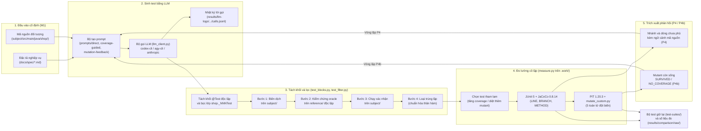

# Hình 3.1: Kiến trúc tổng thể hệ thống sinh và đánh giá kiểm thử bằng LLM

Sơ đồ dưới đây mô tả luồng dữ liệu khép kín giữa đặc tả, mã nguồn đối tượng, mô hình ngôn ngữ lớn (LLM), bộ lọc kiểm chứng hai tầng (`reference/` và `subject/`), hạ tầng đo lường cô lập (JaCoCo, PIT, `mutate_custom.py`) và vòng lặp phản hồi cho P3, P4, P4b.

