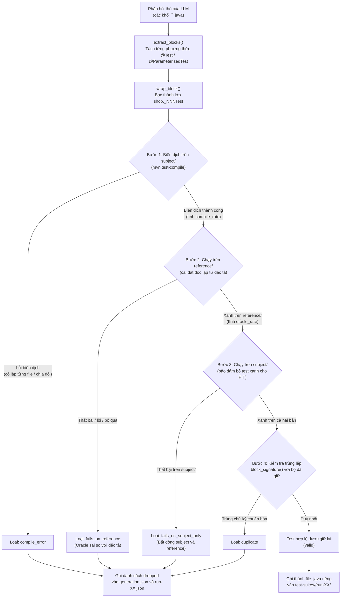

# Hình 3.3: Quy trình lọc test bốn tầng và chứng minh tính đúng oracle

Sơ đồ trình bày chi tiết cách `tools/svv/test_filter.py` kiểm chứng từng khối test do LLM sinh ra trên hai phiên bản cài đặt độc lập (`reference/` và `subject/`), đồng thời ghi nhận chính xác lý do loại để tính tỷ lệ biên dịch (`compile_rate`) và tỷ lệ oracle đúng (`oracle_rate`).

