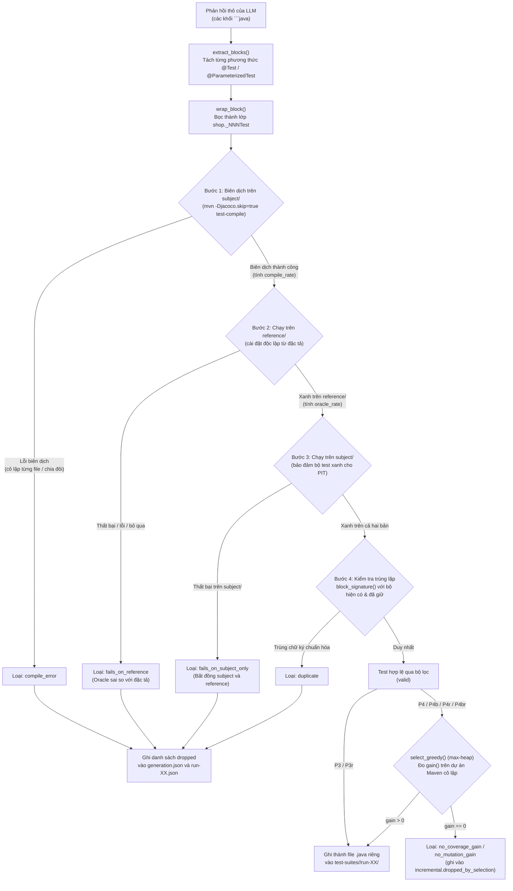

# Hình 3.3: Quy trình lọc test bốn tầng, chứng minh oracle và chọn tham lam lười

Sơ đồ trình bày chi tiết cách `tools/svv/test_filter.py` kiểm chứng từng khối test do LLM sinh ra trên hai phiên bản cài đặt độc lập (`reference/` và `subject/`), ghi nhận lý do loại để tính tỷ lệ biên dịch (`compile_rate`) và tỷ lệ oracle đúng (`oracle_rate`), đồng thời thể hiện bước chọn tham lam lười (`tools/svv/selection.py`) áp dụng cho các chiến lược phản hồi (P4, P4b, P4r, P4br).

