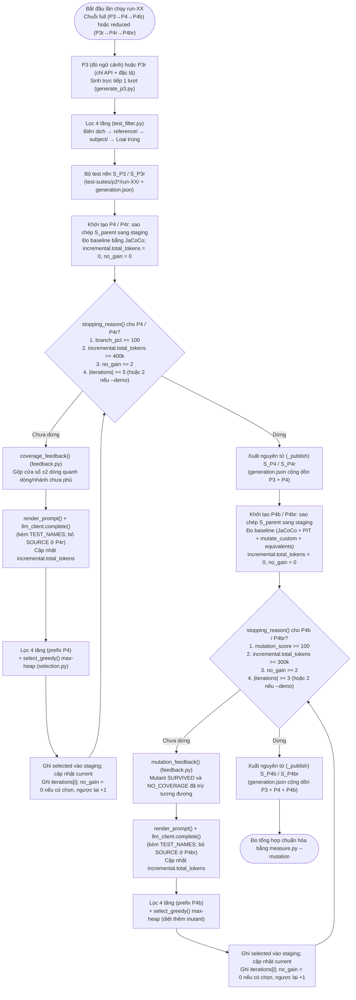

# Hình 3.2: Thiết kế ghép cặp P3 → P4 → P4b (và P3r → P4r → P4br) cùng vòng lặp phản hồi

Sơ đồ minh họa cơ chế kế thừa bộ test theo từng lần chạy (`run-XX`) giữa ba chiến lược LLM (quyết định D-003, D-020, D-024) khớp với mã nguồn `tools/generate_p3.py`, `tools/generate_p4.py` và `tools/svv/selection.py`: P3/P3r sinh bộ nền một lượt, P4/P4r kế thừa và lặp theo phản hồi coverage, P4b/P4br kế thừa bộ cuối của P4/P4r và lặp theo phản hồi mutation.

