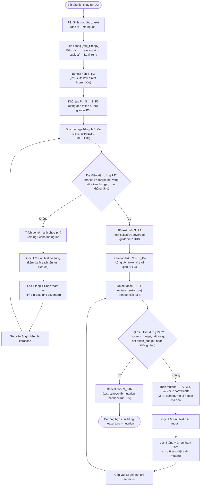

# Hình 3.2: Thiết kế ghép cặp P3 → P4 → P4b và vòng lặp phản hồi

Sơ đồ minh họa cơ chế kế thừa bộ test theo từng lần chạy (`run-XX`) giữa ba chiến lược LLM (quyết định D-003, D-020): P3 sinh bộ nền một lượt, P4 kế thừa P3 và lặp theo phản hồi coverage, P4b kế thừa bộ cuối của P4 và lặp theo phản hồi mutation.

